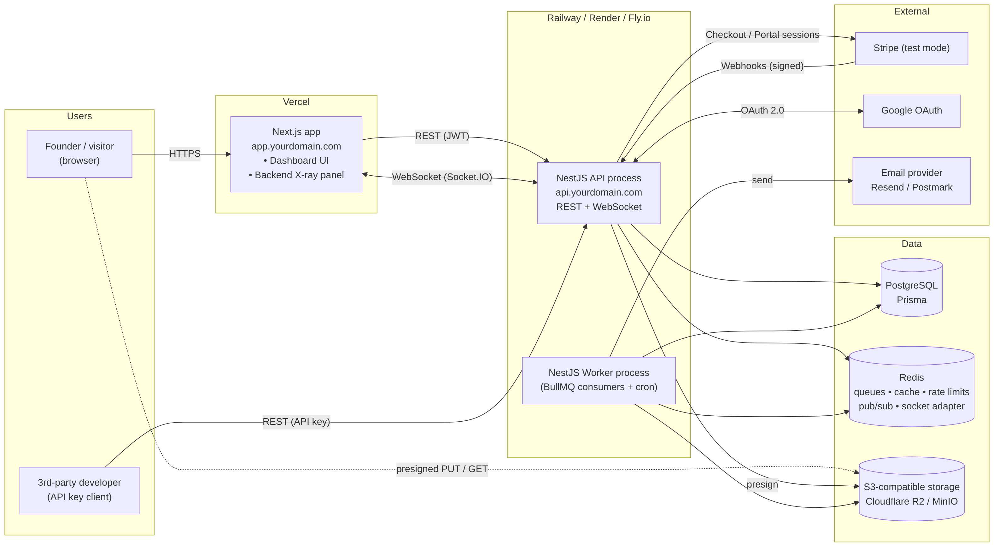
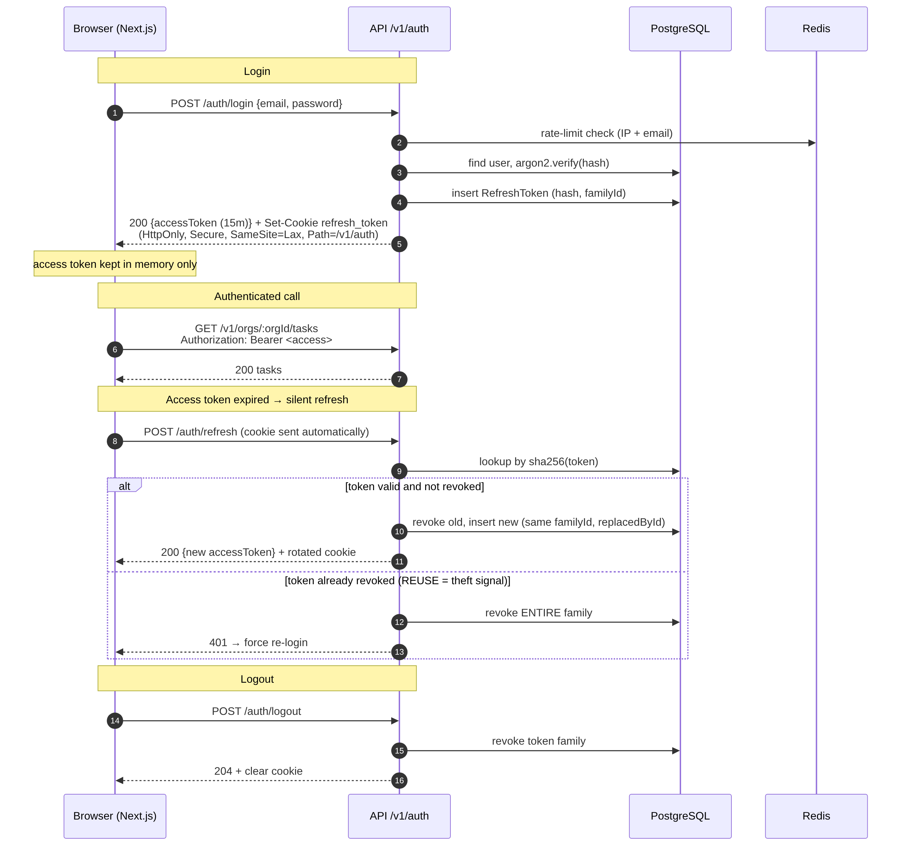

# SaaS X-ray

**A multi-tenant team task & invoice SaaS backend that shows its own work.** Built with NestJS, PostgreSQL and Redis, with a live **Backend X-ray** panel (planned) that narrates what the server does behind every click: auth checks, database queries, queued jobs, rate limits.

This is a portfolio project, built in public, milestone by milestone. The design, with diagrams and the reasoning behind each decision, is in [docs/ARCHITECTURE.md](docs/ARCHITECTURE.md).

> **Last updated:** after Milestone 7 (the "Try demo" button). This README is updated as each milestone lands. See [Roadmap](#roadmap) for what is built and what is next.

## Contents

- [What works today](#what-works-today)
- [Engineering highlights](#engineering-highlights)
- [Tech stack](#tech-stack)
- [Architecture at a glance](#architecture-at-a-glance)
- [Quick start](#quick-start)
- [Try it](#try-it)
- [API](#api)
- [Configuration](#configuration)
- [Database](#database)
- [Testing](#testing)
- [Scripts](#scripts)
- [Deploying](#deploying)
- [Security notes](#security-notes)
- [Project layout](#project-layout)
- [What is (and is not) in git](#what-is-and-is-not-in-git)
- [Roadmap](#roadmap)
- [Troubleshooting](#troubleshooting)

## What works today

| Area                            | Status | Details                                                                                                                          |
| ------------------------------- | :----: | -------------------------------------------------------------------------------------------------------------------------------- |
| Foundation                      |   ✅   | Validated config, structured logging, request ids, RFC 7807 errors, validation, health checks, Swagger                           |
| Data model                      |   ✅   | 18 tables and 11 enums, with integrity rules enforced by the database itself                                                     |
| Demo data                       |   ✅   | One command creates a realistic sample organisation (3 people, 25 tasks, 6 clients, 10 invoices)                                 |
| Authentication                  |   ✅   | Register, login, rotating refresh tokens with reuse detection, email verification, password reset, rate limiting                 |
| Organisations, roles            |   ✅   | Create and manage organisations; owner/admin/member roles enforced on every request; member management with safeguards           |
| Invitations, seat limits        |   ✅   | Invite by email, accept by link, plan seat limits (FREE 3, PRO 25), revoke and re-send                                           |
| Tenant data layer               |   ✅   | A second line of defence: every database query is confined to the current organisation, and cross-organisation links are refused |
| Clients, tasks, invoices        |   ✅   | CRUD with paging and search; invoice numbering, money in cents, and a state machine (DRAFT → SENT → PAID / VOID)                 |
| "Try demo" button               |   ✅   | One click, no sign-up: a private, fully populated sandbox per visitor, role switching, bot protection, auto-cleanup              |
| Billing, jobs, files, real-time |   ⏳   | Planned                                                                                                                          |
| X-ray panel                     |   ⏳   | Planned                                                                                                                          |

Tests at this point: **899** (423 unit, 47 HTTP, 429 integration against real Postgres and Redis).

## Engineering highlights

- **Stolen-token detection.** Refresh tokens rotate on every use. Replaying an old one revokes the whole session, and the server logs it.
- **Defence in depth in the database.** Lower-case emails, non-negative money, one pending invitation per email per organisation and more are enforced by `CHECK` constraints and a partial unique index, so bad data is rejected even if a service has a bug.
- **No account enumeration.** Login gives the same error and spends the same CPU for a wrong password and an unknown email. "Forgot password" always answers `202`.
- **Nothing tunable is hard-coded.** Rate limits, link lifetimes, hashing cost and timeouts are validated environment settings with defaults. See [Configuration](#configuration).
- **Fails fast.** The app refuses to start on a bad environment or an unreachable database, with a message naming the problem and never printing a secret.
- **Tenant isolation at the edge.** Every `/orgs/:orgId/...` route is checked by a guard: non-members get `404` (never `403`, which would confirm the organisation exists), and a route that forgets to declare its required permission is refused rather than left open.
- **Two independent lines of defence against cross-tenant leaks.** The guard stops outsiders at the URL; below it, the database client itself is scoped: every query on tenant data gets the organisation added automatically, a query with no organisation in context is refused, and a foreign key (an invoice's client, a task's assignee) must point at the caller's own organisation. A dedicated suite attacks every endpoint from a second organisation and checks the first is untouched.
- **Roles are looked up on every request**, so a demotion or removal takes effect immediately, even for someone holding a valid token. Role changes re-check the permission under a database lock, and "an organisation always has an owner" holds even when two owners act at the same instant.
- **Secure by default.** Every route requires a token unless it is explicitly marked `@Public()`, so a forgotten decorator makes an endpoint too strict, never open.
- **Tests that try to break it.** The integration suite runs the real app against a real database, and its safeguards were checked by deliberately breaking the code and watching the tests fail.

## Tech stack

| Concern    | Choice                                                                                 |
| ---------- | -------------------------------------------------------------------------------------- |
| Runtime    | Node.js 24, TypeScript 6 (ESM)                                                         |
| Framework  | NestJS 12 (Express)                                                                    |
| Database   | PostgreSQL 16 through Prisma 7 (driver adapter)                                        |
| Cache      | Redis 7 (rate-limit counters now; queues and pub/sub later)                            |
| Auth       | JWT access tokens (`jose`), argon2id (Node built-in `crypto`), HttpOnly refresh cookie |
| Validation | Zod for the environment, class-validator for request bodies                            |
| Email      | Mailpit (development), Resend (production), through a provider adapter                 |
| Logging    | pino, with secret redaction                                                            |
| Tests      | Vitest, Supertest                                                                      |
| Tooling    | oxlint, Prettier, Docker Compose                                                       |

## Architecture at a glance



The API is a modular monolith: global plumbing in `src/core/`, request-pipeline pieces in `src/common/`, and one folder per feature under `src/modules/`. A worker process for background jobs shares the same codebase and arrives with Milestone 10.



More diagrams (request lifecycle, ERD, Stripe webhooks, jobs, the X-ray pipeline) are in [docs/images/](docs/images/), with their sources in [docs/diagrams/](docs/diagrams/).

## Quick start

**Requirements:** Node.js 24.7+ (see `.nvmrc`; the built-in argon2 needs it) and Docker.

```bash
cp .env.example .env
docker compose up -d --wait     # Postgres (host port 5433), Redis, Mailpit
npm install                     # also generates the Prisma client
npm run db:migrate              # create the tables
npm run db:seed                 # optional: a sample "Acme Studio" organisation
npm run start:dev
```

Then open:

| What                        | Where                                                  |
| --------------------------- | ------------------------------------------------------ |
| API                         | <http://localhost:3000> (versioned routes under `/v1`) |
| Swagger UI                  | <http://localhost:3000/docs> (JSON at `/docs-json`)    |
| Health                      | `GET /health/live` and `GET /health/ready`             |
| Mailpit (development inbox) | <http://localhost:8025>                                |

Postgres is exposed on **5433**, not the default 5432, so it cannot clash with a Postgres already installed on your machine.

> **WSL users:** keep the repo on the Linux filesystem (for example `~/saas-xray`), not under `/mnt/c`. Node loads thousands of small files at startup and the Windows mount makes that about 30 times slower.

## Try it

**In Swagger** (<http://localhost:3000/docs>): call `POST /v1/auth/register`, copy the `accessToken` from the response, click **Authorize** and paste it. Then call `GET /v1/auth/me`. The verification email appears in Mailpit.

**The stolen-token test** (curl):

```bash
B=http://localhost:3000/v1; J=/tmp/jar.txt; : > $J
curl -s -c $J -X POST $B/auth/register -H 'content-type: application/json' \
  -d '{"email":"demo@example.com","password":"a long passphrase here","name":"Demo"}' >/dev/null

cp $J /tmp/jar-stolen.txt                                  # an attacker copies the cookie
curl -s -b $J -c $J -o /dev/null -w "real user refreshes:  %{http_code}\n" -X POST $B/auth/refresh
curl -s -b /tmp/jar-stolen.txt -o /dev/null -w "attacker replays:       %{http_code}\n" -X POST $B/auth/refresh
curl -s -b $J -o /dev/null -w "real user's newest token: %{http_code}\n" -X POST $B/auth/refresh
```

Expected: `200`, `401`, `401`. The last `401` is the point: the replay revoked the whole session.

## API

Every route needs a token unless it is marked public. Errors are RFC 7807 `application/problem+json` with a stable `code` and the `requestId`.

### Authentication (`/v1/auth`)

| Endpoint                                          | What it does                                                                                        |
| ------------------------------------------------- | --------------------------------------------------------------------------------------------------- |
| `POST /register`                                  | Create an account and sign in. Sends a verification email                                           |
| `POST /login`                                     | Email and password. Same error for a wrong password and an unknown email                            |
| `POST /refresh`                                   | New access token from the refresh cookie. Rotates the cookie; replaying an old one ends the session |
| `POST /logout`, `POST /logout-all`                | End this session, or every session                                                                  |
| `POST /verify-email`, `POST /resend-verification` | Single-use verification link                                                                        |
| `POST /forgot-password`, `POST /reset-password`   | Always answers `202`. The link is single-use, short-lived, and signs out every session              |
| `GET /me`                                         | The signed-in user and their organisations                                                          |

The access token (15 minutes by default) goes in `Authorization: Bearer ...` and should be kept in memory. The refresh token lives only in an `HttpOnly` cookie scoped to `/v1/auth`, and only its SHA-256 hash is stored. Not built yet: Google sign-in (it needs OAuth credentials).

### Organisations (`/v1/orgs`)

| Endpoint              | Who          | What it does                                                   |
| --------------------- | ------------ | -------------------------------------------------------------- |
| `POST /orgs`          | anyone       | Create an organisation; you become its OWNER, on the FREE plan |
| `GET /orgs`           | anyone       | The organisations you belong to, with your role in each        |
| `GET /orgs/:orgId`    | any member   | One organisation: your role, plan, member count                |
| `PATCH /orgs/:orgId`  | owner, admin | Rename it (the slug never changes)                             |
| `DELETE /orgs/:orgId` | owner        | Delete it and everything it owns. Irreversible                 |

### Members (`/v1/orgs/:orgId/members`)

| Endpoint              | Who          | What it does                                   |
| --------------------- | ------------ | ---------------------------------------------- |
| `GET /members`        | any member   | The team: name, email, role                    |
| `PATCH /members/:id`  | owner, admin | Change a role                                  |
| `DELETE /members/:id` | owner, admin | Remove a member (their tasks stay, unassigned) |
| `POST /members/leave` | any member   | Leave the organisation                         |

Rules: you cannot change your own role; only an owner can change an owner or grant ownership (transfer it by promoting the successor, who then steps the old owner down); the last owner cannot leave or be removed; an admin cannot touch an owner. Everyone not in the organisation gets `404`, whether or not it exists.

### Invitations

| Endpoint                                   | Who          | What it does                                                             |
| ------------------------------------------ | ------------ | ------------------------------------------------------------------------ |
| `POST /orgs/:orgId/invitations`            | owner, admin | Invite an email as ADMIN or MEMBER. Needs a verified email. Holds a seat |
| `GET /orgs/:orgId/invitations`             | owner, admin | All invitations, newest first (expired ones marked)                      |
| `POST /orgs/:orgId/invitations/:id/resend` | owner, admin | New link and expiry; the old link stops working                          |
| `DELETE /orgs/:orgId/invitations/:id`      | owner, admin | Cancel it; the link stops working                                        |
| `POST /invitations/preview`                | anyone       | What a link is for (organisation, email, role), so sign-up can pre-fill  |
| `POST /invitations/accept`                 | signed in    | Join. The account's email must be the invited one. Single use            |

How it works: the emailed link carries a 256-bit token that is stored only as a hash. A **seat** is a member or an unexpired pending invitation, so you cannot out-invite your plan (`402` with an upgrade link when full; `FREE_PLAN_MAX_SEATS` / `PRO_PLAN_MAX_SEATS`). Every wrong-token case (unknown, expired, revoked, used, wrong account) gets the identical `400`, so none can be told apart. Accepting is an atomic claim, so a link opened twice at once works exactly once. Ownership is never granted by invitation. Demo accounts cannot invite.

Roles and permissions are one table in [src/modules/tenancy/permissions.ts](src/modules/tenancy/permissions.ts), checked against the table in [ARCHITECTURE §8.3](docs/ARCHITECTURE.md) by a test. Creating organisations is capped per user (`MAX_ORGS_PER_USER`, default 5) and rate limited (`RATE_LIMIT_ORG_CREATE_PER_HOUR`).

### Try the demo (`/v1/auth/demo`, `/v1/demo/switch-role`)

| Endpoint                 | Who          | What it does                                                                                         |
| ------------------------ | ------------ | ---------------------------------------------------------------------------------------------------- |
| `POST /auth/demo`        | anyone       | Creates a private sandbox (3 people, 25 tasks, 6 clients, 10 invoices) and signs you in as its owner |
| `POST /demo/switch-role` | demo account | Become the sandbox's `OWNER`, `ADMIN` or `MEMBER` to feel role-based access; replaces your session   |

The response is a normal login (access token in the body, refresh token in the cookie) plus the sandbox `organization`, your `role` and when it `expiresAt`. A warm request takes about 0.3 s.

- **Isolated:** every visitor gets their own organisation; nothing is shared and nobody can see anyone else's.
- **Safe by construction:** demo accounts cannot create organisations or invite people, have no password, and invoices sent from a sandbox send no real email.
- **Temporary:** a sandbox lives `DEMO_TTL_HOURS` (default 24). Expired sandboxes, everything in them and their demo users are deleted by a cleanup that runs every `DEMO_PURGE_INTERVAL_MINUTES` (it becomes a queue job later). The sample organisation from `npm run db:seed` is never purged.
- **Protected:** rate limited per IP (`RATE_LIMIT_DEMO_PER_HOUR`), capped at `DEMO_MAX_ACTIVE` live sandboxes (answers `503` when busy), and, when `TURNSTILE_SECRET_KEY` is set, requires a Cloudflare Turnstile token in the body (`{ "turnstileToken": "..." }`). The captcha fails closed: if Cloudflare cannot be reached, nobody gets a sandbox. `DEMO_ENABLED=false` switches the whole feature off (it then answers `404`).

### Clients (`/v1/orgs/:orgId/clients`)

| Endpoint              | Who          | What it does                                                             |
| --------------------- | ------------ | ------------------------------------------------------------------------ |
| `GET /clients`        | any member   | A to Z (case-insensitive), `?q=` search, `?limit=` and `?cursor=` paging |
| `GET /clients/:id`    | any member   | One client                                                               |
| `POST /clients`       | owner, admin | Create. Email is unique per organisation (`409`)                         |
| `PATCH /clients/:id`  | owner, admin | Change name or email                                                     |
| `DELETE /clients/:id` | owner, admin | Delete. A client that has invoices cannot be deleted (`409`)             |

### Tasks (`/v1/orgs/:orgId/tasks`)

| Endpoint            | Who        | What it does                                                                        |
| ------------------- | ---------- | ----------------------------------------------------------------------------------- |
| `GET /tasks`        | any member | Newest first. Filter by `status`, `priority`, `assigneeId` (or `me`), `q`; page     |
| `GET /tasks/:id`    | any member | One task, with the assignee's name                                                  |
| `POST /tasks`       | any member | Create. The creator is recorded; the assignee must be a member of this organisation |
| `PATCH /tasks/:id`  | see below  | Partial update. Send `null` to clear the assignee or due date                       |
| `DELETE /tasks/:id` | see below  | Soft delete (the row stays, hidden everywhere)                                      |

Owners and admins can edit or delete any task. A **member** can edit tasks they created or are assigned to, reassign only tasks they created, and delete only tasks they created.

### Invoices (`/v1/orgs/:orgId/invoices`)

| Endpoint                  | Who          | What it does                                                                         |
| ------------------------- | ------------ | ------------------------------------------------------------------------------------ |
| `GET /invoices`           | any member   | Newest first. Filter by `status`, `clientId`, number `q`; page. Line-item count only |
| `GET /invoices/:id`       | any member   | One invoice with its line items                                                      |
| `POST /invoices`          | owner, admin | Create a DRAFT. The server assigns the number and computes the total                 |
| `PATCH /invoices/:id`     | owner, admin | Edit a DRAFT. Sending `items` replaces all lines                                     |
| `DELETE /invoices/:id`    | owner, admin | Soft-delete a DRAFT. Anything that was sent is voided instead                        |
| `POST /invoices/:id/send` | owner, admin | DRAFT → SENT. Needs a priced line item; sets the due date; emails the client         |
| `POST /invoices/:id/pay`  | owner, admin | SENT or OVERDUE → PAID                                                               |
| `POST /invoices/:id/void` | owner, admin | DRAFT, SENT or OVERDUE → VOID. A paid invoice cannot be voided                       |

```
DRAFT ──send──▶ SENT ──pay──▶ PAID        (SENT → OVERDUE is a scheduled job, planned)
  │               └──void──▶ VOID
  └──void──▶ VOID
```

How the numbers stay right: money is whole **cents** in 32-bit integers (a total that would overflow is refused), the total is always computed on the server from the lines, numbers (`INV-0001`...) come from a per-organisation counter incremented atomically inside the creating transaction (no duplicates, no gaps, even for simultaneous requests), and every status change is an atomic claim, so two simultaneous "send" clicks cannot both win. Illegal moves answer `409 INVALID_STATE_TRANSITION`.

**Lists** use cursor (keyset) paging: `{ data, nextCursor }`. Unlike offsets, rows added or deleted between requests never cause duplicates or skips. Page size defaults to `PAGE_SIZE_DEFAULT` and is capped by `PAGE_SIZE_MAX`. Searches treat `%` and `_` as ordinary characters.

More endpoints are documented in Swagger as they are added.

## Configuration

Nothing that is sensitive or tunable is hard-coded. Every setting is read from the environment, validated at boot (a bad value stops the app with a message naming the variable, never its value), and documented in [.env.example](.env.example). Every tunable has a default, so a minimal `.env` works. They include:

- **Secrets and credentials:** `JWT_ACCESS_SECRET`, `DATABASE_URL`, `RESEND_API_KEY`, the Postgres password.
- **Security policy:** link lifetimes (`EMAIL_VERIFY_TTL_HOURS`, `PASSWORD_RESET_TTL_MINUTES`), session lengths, password-hashing cost (`PASSWORD_HASH_*`), and every rate limit (`RATE_LIMIT_*`).
- **Timeouts and retries:** database, mail, health checks, Redis, CORS cache.
- **Ports and the demo** (`DEMO_ENABLED`, `DEMO_TTL_HOURS`, `DEMO_MAX_ACTIVE`, `DEMO_PURGE_*`, `TURNSTILE_SECRET_KEY`).

Numbers that are _not_ settings stay in code, named, with a comment: time units (`src/common/time.ts`), limits that come from a standard or the API contract such as the 254-character email maximum and the password length bounds (`src/common/limits.ts`), and hard safety bounds on untrusted input (`src/core/config/security-limits.ts`). Changing those changes what clients may send, so they go through code review rather than a deploy setting.

**Production:** set a real `JWT_ACCESS_SECRET` (`openssl rand -base64 48`); the app refuses to start in production with the example value. Set `MAIL_DRIVER=resend` and `RESEND_API_KEY`.

## Database

The schema lives in [prisma/schema.prisma](prisma/schema.prisma) and its history in `prisma/migrations/`. Some rules Prisma's schema language cannot express (lower-case emails, one pending invitation per email per organisation, no negative money) are written by hand at the bottom of the first migration. After editing the schema, run `npm run db:migrate:dev`, then **review the generated SQL before committing it**.

A foreign key proves a task's assignee or an invoice's client _exists_, not that it belongs to the _same organisation_. The tenant-scoped data layer closes that gap: every write that stores such a reference first checks it points at the caller's own organisation (the list of those references is checked against `schema.prisma` by a test, so a new one cannot be forgotten). See [ARCHITECTURE §6 and §8.2](docs/ARCHITECTURE.md).

### Looking at the tables (pgAdmin, DBeaver, psql)

The app's database is the **Docker** Postgres, not any Postgres installed on your machine (that one usually owns port 5432 and has its own `postgres` database, which stays empty). Register a new server in pgAdmin with:

| Field                | Value                                                                    |
| -------------------- | ------------------------------------------------------------------------ |
| Host                 | `localhost`                                                              |
| Port                 | `5433` (`POSTGRES_PORT` in `.env`)                                       |
| Maintenance database | `saas_xray`                                                              |
| Username / password  | `POSTGRES_USER` / `POSTGRES_PASSWORD` in `.env` (also in `DATABASE_URL`) |

Then open **Servers → this server → Databases → saas_xray → Schemas → public → Tables** (right-click → Refresh). From a terminal: `docker compose exec postgres psql -U postgres -d saas_xray -c '\dt'`.

## Testing

Three layers, from fast to thorough:

| Layer       | Command                    | What it covers                                                                                                                       | Needs Docker |
| ----------- | -------------------------- | ------------------------------------------------------------------------------------------------------------------------------------ | :----------: |
| Unit        | `npm test`                 | Pure logic: config validation, password hashing, token signing, templates, error mapping                                             |      No      |
| HTTP        | `npm run test:e2e`         | The real app configuration over HTTP, with Postgres and Redis stubbed                                                                |      No      |
| Integration | `npm run test:integration` | The real app against real Postgres and Redis: schema rules, cascades, seed, the whole auth flow, rate limiting, settings from `.env` |     Yes      |

`npm run check` runs typecheck, lint, unit and HTTP tests. `npm run check:full` adds the integration tests; run it before pushing.

Integration tests use a separate `saas_xray_test` database and refuse to run against any database whose name does not end in `_test`.

## Scripts

| Command                                | What it does                                                                                                                                                                |
| -------------------------------------- | --------------------------------------------------------------------------------------------------------------------------------------------------------------------------- |
| `npm run start:dev`                    | Run with hot reload                                                                                                                                                         |
| `npm run build` / `npm run start:prod` | Compile to `dist/` and run it                                                                                                                                               |
| `npm run typecheck`                    | `tsc --noEmit`                                                                                                                                                              |
| `npm run lint`                         | oxlint (type-aware)                                                                                                                                                         |
| `npm run format` / `format:check`      | Prettier                                                                                                                                                                    |
| `npm run check` / `check:full`         | Everything above plus tests (see [Testing](#testing))                                                                                                                       |
| `npm run db:migrate`                   | Apply pending migrations, then regenerate the Prisma client                                                                                                                 |
| `npm run db:migrate:deploy`            | Apply pending migrations only (what the production container runs on start)                                                                                                 |
| `npm run db:migrate:dev`               | Create a new migration after editing `prisma/schema.prisma`                                                                                                                 |
| `npm run db:status`                    | Show which migrations are applied                                                                                                                                           |
| `npm run db:seed`                      | (Re)create the sample organisation. Safe to repeat; refuses to run in production                                                                                            |
| `npm run demo:prep`                    | Before recording a demo video: creates a real account, organisation and client, empties Mailpit, prints a fresh token and ready-to-paste bodies. Local only; safe to repeat |
| `npm run demo:stolen-token`            | Plays out a stolen refresh-token attack with clean labelled output (`200`, `401`, `401`). Exits non-zero if the server behaves differently. Local only                      |
| `npm run db:generate`                  | Regenerate the Prisma client (after any schema change)                                                                                                                      |

## Deploying

The API ships as one Docker image ([Dockerfile](Dockerfile)): multi-stage, runs as a non-root user, applies pending database migrations on start ([docker/entrypoint.sh](docker/entrypoint.sh)), and has a liveness healthcheck. It works on any host that runs containers (Railway, Render, Fly.io, a VPS).

**Try the production image on your machine** (a throwaway stack with its own database, separate from development):

```bash
export POSTGRES_PASSWORD="$(openssl rand -hex 24)"
export JWT_ACCESS_SECRET="$(openssl rand -base64 48)"
export WEB_ORIGIN="http://localhost:3001"
docker compose -f docker-compose.prod.yml up -d --build --wait   # first build takes several minutes
curl http://localhost:3000/health/ready                          # {"status":"ok", postgres up, redis up}
docker compose -f docker-compose.prod.yml down -v                # remove it and its data
```

[docker-compose.prod.yml](docker-compose.prod.yml) refuses to start without the secrets, publishes nothing but the API on localhost, and is also a valid single-server deployment when a reverse proxy with HTTPS sits in front.

**On a managed platform**, create the API service from this repository's Dockerfile, add Postgres and Redis, and set at least:

| Variable                               | Value                                                                                                                  |
| -------------------------------------- | ---------------------------------------------------------------------------------------------------------------------- |
| `NODE_ENV`                             | `production`                                                                                                           |
| `DATABASE_URL`, `REDIS_URL`            | From the platform's Postgres and Redis                                                                                 |
| `JWT_ACCESS_SECRET`                    | `openssl rand -base64 48`. The app refuses to start in production with the example value                               |
| `WEB_ORIGIN`                           | The exact origin of the web app, for CORS (no wildcards)                                                               |
| `TRUST_PROXY_HOPS`                     | `1` behind a platform load balancer, so rate limiting sees real client IPs                                             |
| `MAIL_DRIVER`, `RESEND_API_KEY`        | `resend` and your key; with `smtp`, set `SMTP_URL`                                                                     |
| `MAIL_FROM`                            | A sender on a domain you verified with your email provider                                                             |
| `TURNSTILE_SECRET_KEY` (recommended)   | Protects the public demo button from bots                                                                              |

Every other setting has a default; the full list is in [.env.example](.env.example). Use the platform's health check on `/health/ready`. Set `RUN_MIGRATIONS=false` if the platform runs `npm run db:migrate:deploy` as its own release step.

**Domain note:** the refresh token is a `SameSite=Lax` cookie. The API and the web app must share a registrable domain (for example `api.example.com` and `app.example.com`), or sign-in will not persist in browsers that block third-party cookies.

**CI** ([.github/workflows/ci.yml](.github/workflows/ci.yml)) runs on every push and pull request: Prisma schema validation, formatting, typecheck, lint, all three test layers against Postgres and Redis service containers, and a second job that builds this image and boots it on a fresh database. A change that breaks the image or a migration fails the build.

## Security notes

- Passwords: argon2id, with the cost configurable and stored inside each hash so it can be raised later without locking anyone out.
- Tokens: refresh, verification and reset tokens are 256 bits of randomness, shown once and stored only as SHA-256 hashes. Verification and reset links are single use, enforced by an atomic database update.
- Sessions: rotation with reuse detection; the absolute session length is capped even if the user keeps refreshing.
- CSRF: the refresh cookie is `HttpOnly`, `SameSite=Lax` and scoped to `/v1/auth`; refresh and logout also reject any request whose `Origin` is not the web app.
- Tenant data layer: domain code (clients, tasks, invoices) can only reach the database through a scoped client (a test forbids importing the unscoped one). It refuses to run without an organisation in context, refuses raw SQL and non-tenant tables, and runs its foreign-key checks on the transaction's own connection so a burst of concurrent requests cannot exhaust the connection pool.
- Tenancy: every organisation route checks membership first and returns `404` to outsiders. Permissions are declared per route (`@RequirePermission`) and enforced by a guard that fails closed. Role changes are serialised by a row lock and re-checked against the role held _now_, not the one seen a moment earlier.
- Rate limiting: Redis-backed so limits hold across servers; credential endpoints are limited per IP **and** email. If Redis is down the limiter fails open and logs, rather than locking everyone out.
- Logs never contain authorization headers, cookies, API keys or password/token fields.
- Unknown request fields are rejected (`400`), which closes off mass-assignment.

**Honest trade-offs**, also recorded in [ARCHITECTURE §7](docs/ARCHITECTURE.md): an access token that was already issued stays valid until it expires (15 minutes by default) after logout or a password reset; and registering an email that already exists answers `409`, which reveals that the address is registered.

## Project layout

```text
src/
├── main.ts               bootstrap
├── configure-app.ts      app-level setup shared by main.ts and tests
├── swagger.ts
├── core/                 global, cross-cutting providers
│   ├── config/           zod-validated environment
│   ├── context/          per-request context (request id, signed-in user)
│   ├── logger/           pino + redaction
│   ├── prisma/  redis/
│   ├── mail/             SMTP and Resend transports, email templates
│   ├── background/       fire-and-forget work (moves to a queue in Milestone 10)
│   ├── rate-limit/       Redis-backed limiter and named policies
│   └── health/
├── common/               error filter, validation pipe, timeout interceptor, domain errors
├── modules/
│   ├── auth/             register, login, sessions, email verification, password reset
│   ├── tenancy/          tenant and permission guards, the role/permission table
│   ├── organizations/    create, read, rename, delete
│   ├── memberships/      team list, role changes, removal, leaving
│   ├── invitations/      invite, resend, revoke, preview, accept
│   ├── clients/  tasks/  invoices/   the product domain (tenant-scoped client only)
│   ├── demo/             sandbox creation, role switching, expiry cleanup, captcha
│   └── billing/          plan entitlements (seat limits); Stripe arrives later
└── seed/                 demo organisation template (db:seed, later "Try demo")
prisma/                   schema and migrations
Dockerfile  docker/       production image and its start-up script
docker-compose.yml        development services (Postgres, Redis, Mailpit)
docker-compose.prod.yml   production-like stack: the image + Postgres + Redis
.github/workflows/        CI
test/                     HTTP and integration tests, and their helpers
docs/                     architecture, diagrams and images
```

## What is (and is not) in git

[.gitignore](.gitignore) explains every rule in its own comments. In short: **secrets** (`.env` and any `.env.*` except `.env.example`, keys, certificates), **rebuildable output** (`dist/`, `node_modules/`, the generated Prisma client in `src/generated/`), **logs and database dumps**, and **editor and OS files** stay out. Migrations in `prisma/migrations/` and `.env.example` are committed on purpose. To see why a file is ignored: `git check-ignore -v <path>`.

If a secret is ever committed by mistake, rotate it immediately. Deleting the commit is not enough once it has been pushed.

## Roadmap

Mirrors [ARCHITECTURE §26](docs/ARCHITECTURE.md). ✅ built, ⏳ planned.

**Phase 1: pitchable core**

- ✅ Docker Compose, config, Prisma, logger, request context, health
- ✅ Database schema and migrations, demo seed data
- ✅ Global error filter, validation, Swagger
- ✅ Authentication: register, login, refresh rotation, verify, reset
- ⏳ Google sign-in
- ✅ Organisations, members, roles and permissions (guards at the edge)
- ✅ Tenant-scoped data access layer (the second line of defence below the guards)
- ✅ Invitations, with plan seat limits
- ✅ Clients, tasks and invoices, with the invoice state machine
- ⏳ Invoice `Idempotency-Key` header and the overdue job (arrives with the job queue)
- ✅ "Try demo" endpoint, role switching, sandbox cleanup
- 🟡 Deploy: production image, migrations on start and CI are done and verified; going live needs a hosting account and a domain

**Phase 2: SaaS platform**

- ⏳ Job queue and email worker, then a separate worker process
- ⏳ Stripe checkout, webhooks and plan limits
- ⏳ File uploads, real-time notifications, reports and invoice PDFs
- ⏳ API keys, caching

**Phase 3: show-off and quality**

- ⏳ The Backend X-ray panel
- ⏳ Audit log
- ✅ Tenant-isolation test suite
- ⏳ GitHub Actions CI
- ⏳ Demo video and case study

## Troubleshooting

| Symptom                                                     | Cause and fix                                                                                                                  |
| ----------------------------------------------------------- | ------------------------------------------------------------------------------------------------------------------------------ |
| App exits at start naming an environment variable           | Working as intended: fix that variable in `.env` (compare with `.env.example`)                                                 |
| `Cannot reach the database` at start                        | Postgres is not running: `docker compose up -d --wait`. Check the port in `DATABASE_URL` matches `POSTGRES_PORT`               |
| pgAdmin shows no tables                                     | You are connected to a different Postgres. Use host `localhost`, port `5433`, database `saas_xray` (see [Database](#database)) |
| Prisma errors about missing models or enums after migrating | The generated client is stale: `npm run db:generate` (`npm run db:migrate` does both steps)                                    |
| `crypto.argon2 is not a function`                           | Node is older than 24.7: `nvm use` (see `.nvmrc`)                                                                              |
| Everything is very slow under WSL                           | The repo is on `/mnt/c`. Move it to the Linux filesystem (for example `~/saas-xray`)                                           |
| A port is already in use                                    | Change `POSTGRES_PORT`, `REDIS_PORT` or `MAILPIT_*_PORT` in `.env` (and the matching URL), then `docker compose up -d`         |
| Verification or reset email never arrives                   | Open Mailpit at <http://localhost:8025>. In production check `MAIL_DRIVER` and `RESEND_API_KEY`                                |
| `429 Too Many Requests` while testing                       | Rate limits at work. Wait a minute, or raise the relevant `RATE_LIMIT_*` value in `.env` for local testing                     |

## License

Not licensed for reuse yet (`UNLICENSED`). All rights reserved.
