# Architecture Design — Multi-Tenant Team Task & Invoice SaaS (with "Backend X-ray")

> **Purpose of this document:** the single source of truth for how the system is built and why.
> It is written so you can (a) build it module by module, (b) defend every decision on a client call,
> and (c) lift sections straight into the README and case study.

| | |
|---|---|
| **Status** | Draft v1.0 — pending confirmation of the decisions in [§19](#19-decisions-to-confirm-before-building) |
| **Owner** | Backend developer (NestJS), Lagos, Nigeria (UTC+1) |
| **Audience** | You, future collaborators, and technical founders reviewing the portfolio |
| **Stack** | NestJS · PostgreSQL + Prisma · Redis + BullMQ · Socket.IO · Next.js · Docker · Stripe · S3-compatible storage |

---

## Table of contents

1. [Goals, non-goals and quality attributes](#1-goals-non-goals-and-quality-attributes)
2. [System context](#2-system-context)
3. [Repository and folder structure](#3-repository-and-folder-structure)
4. [Backend module architecture](#4-backend-module-architecture)
5. [Request lifecycle (guards, pipes, interceptors, filters)](#5-request-lifecycle)
6. [Data model](#6-data-model)
7. [Authentication](#7-authentication)
8. [Multi-tenancy and RBAC](#8-multi-tenancy-and-rbac)
9. [Core domain: tasks, clients, invoices](#9-core-domain-tasks-clients-invoices)
10. [Payments: Stripe subscriptions and webhooks](#10-payments-stripe-subscriptions-and-webhooks)
11. [Background jobs (BullMQ)](#11-background-jobs-bullmq)
12. [Real-time (WebSockets)](#12-real-time-websockets)
13. [File uploads (S3 presigned URLs)](#13-file-uploads)
14. [Public API: keys, rate limiting, versioning, Swagger](#14-public-api)
15. [Reliability: validation, errors, logging, health, caching](#15-reliability)
16. [Audit log](#16-audit-log)
17. [Backend X-ray panel](#17-backend-x-ray-panel)
18. ["Try demo" flow](#18-try-demo-flow)
19. [Decisions to confirm before building](#19-decisions-to-confirm-before-building)
20. [Security model](#20-security-model)
21. [Testing strategy](#21-testing-strategy)
22. [Local development, Docker and CI/CD](#22-local-development-docker-and-cicd)
23. [Deployment and environments](#23-deployment-and-environments)
24. [Configuration and environment variables](#24-configuration-and-environment-variables)
25. [Scalability and future evolution](#25-scalability-and-future-evolution)
26. [Delivery roadmap mapped to the architecture](#26-delivery-roadmap)
27. [Talking points for client calls](#27-talking-points-for-client-calls)

---

## 1. Goals, non-goals and quality attributes

### 1.1 Goals
- **Look like a real startup backend.** A founder who clicks around should recognise the patterns their own company needs: orgs, roles, billing, background jobs, webhooks, a public API.
- **Make the backend visible.** The X-ray panel turns invisible work (cache hits, queued jobs, webhooks, rate limits) into a live, plain-English timeline.
- **Ship fast in phases.** Phase 1 must be deployable and pitchable on its own.
- **Be defensible.** Every non-obvious choice has a short "why" in this doc.

### 1.2 Non-goals (deliberately out of scope)
- Microservices, Kubernetes, event sourcing, CQRS. A **modular monolith** is the honest answer for an early-stage startup and the right signal to send to founders.
- Complex task-management features (Gantt, sprints, custom fields). The product theme stays thin; the backend is the star.
- Real money. Stripe is test mode only.
- Multi-region, multi-database tenancy.

### 1.3 Quality attributes (what "good" means here)

| Attribute | Target | How it is achieved |
|---|---|---|
| **Security** | No cross-tenant data leaks; OWASP top-10 basics covered | Tenant-scoped Prisma client, guards, hashed tokens, signed webhooks, rate limits (§8, §20) |
| **Reliability** | Webhooks and jobs never lost or double-processed | Idempotency table, BullMQ retries, dead-letter set (§10, §11) |
| **Observability** | Any request traceable end-to-end by `requestId` | Pino structured logs, request context, X-ray events (§15, §17) |
| **Performance** | p95 < 200 ms for CRUD on free-tier hosting | Indexed tenant queries, Redis cache-aside, async heavy work |
| **Maintainability** | Feature = one Nest module; no circular imports | Layered module map (§4), shared types package |
| **Demo-ability** | Visitor in the app in < 3 s with zero sign-up | Per-visitor sandbox org seeded on demand (§18) |
| **Cost** | ≈ $0–10 / month | Free tiers: Vercel, Neon/Railway Postgres, Railway Redis, Cloudflare R2 |

---

## 2. System context

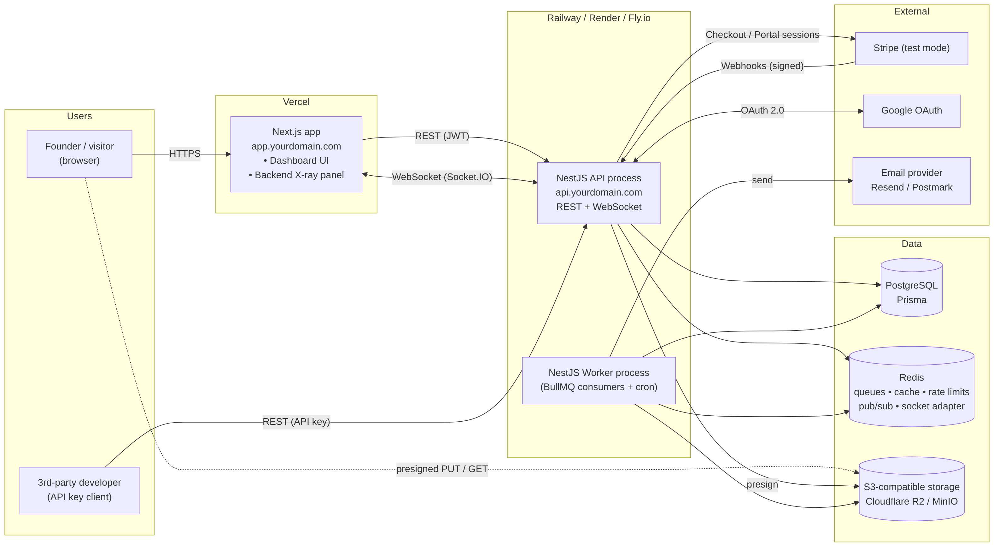

### 2.1 Components

| Component | Responsibility | Runs on |
|---|---|---|
| **Next.js web app** | Dashboard UI, X-ray panel, auth screens, marketing/landing with "Try demo" | Vercel |
| **NestJS API process** | REST API (`/v1`), WebSocket gateway, Stripe webhook receiver, Swagger | Railway / Render / Fly.io |
| **NestJS Worker process** | BullMQ consumers (email, reports, billing), repeatable cron jobs | Same host, separate service, **same codebase** |
| **PostgreSQL** | System of record | Managed Postgres (Railway / Neon / Supabase) |
| **Redis** | BullMQ queues, cache, rate-limit counters, pub/sub for X-ray, Socket.IO adapter | Railway Redis (see §23.3 on why not Upstash for BullMQ) |
| **S3-compatible storage** | Attachments, generated PDFs/CSVs | Cloudflare R2 (prod), an S3-compatible container locally (chosen in Milestone 12; see §22.1) |
| **Stripe** | Subscriptions, Checkout, Customer Portal, webhooks | External (test mode) |
| **Google OAuth** | Social login | External |
| **Email provider** | Transactional email | Resend or Postmark (prod), Mailpit (local) |

### 2.2 Why API and Worker are separate processes (same code)
- A slow PDF render or email retry storm must not steal CPU from HTTP requests.
- They scale independently (more workers when queues back up).
- Same repository and Docker image; only the entrypoint differs (`main.ts` vs `worker.ts`). This is cheap to explain and cheap to run.
- **Phase 1 shortcut:** run both in one process (`RUN_WORKERS=true`) until Phase 2 if you want to save a service on the host.

### 2.3 Domains and cookies (important — decide early)
Put both apps under **one registrable domain**:
`app.yourdomain.com` (Vercel) and `api.yourdomain.com` (backend).

The refresh-token cookie is then **same-site**, so `SameSite=Lax` works and browsers that block third-party cookies (Safari, Chrome's tracking protections) don't break login. If the API sits on `*.up.railway.app` and the web app on `*.vercel.app`, the cookie becomes third-party and refresh will fail in some browsers. Fallback if you have no domain: proxy `/api/*` through Next.js rewrites so the browser only ever talks to the Vercel origin.

---

## 3. Repository and folder structure

**Recommendation:** a single **pnpm workspaces monorepo** (decision D1 in §19).

> **As built (Milestones 0–1):** the API currently lives in its own repository, with `src/` at the root and **npm** as the package manager, so the `apps/api/...` paths below map to `./...`. The Next.js app and `packages/shared` will be added later (either as a sibling repo or by moving into the monorepo), so D1 stays open. Tests run on **Vitest** (not Jest), linting uses **oxlint**, and the ORM is **Prisma 7** with the `@prisma/adapter-pg` driver adapter; its generated client lives in `src/generated/prisma` (git-ignored, rebuilt by `npm install`).

```
saas-xray/
├── apps/
│   ├── api/                         # NestJS (API + worker entrypoints)
│   │   ├── src/
│   │   │   ├── main.ts              # HTTP + WS bootstrap
│   │   │   ├── worker.ts            # BullMQ processors + cron bootstrap
│   │   │   ├── app.module.ts
│   │   │   ├── worker.module.ts
│   │   │   ├── core/                # global, cross-cutting
│   │   │   │   ├── config/          # env schema (zod), typed ConfigService
│   │   │   │   ├── prisma/          # PrismaService + tenant extension
│   │   │   │   ├── redis/
│   │   │   │   ├── context/         # nestjs-cls: requestId, userId, orgId, actor
│   │   │   │   ├── logger/          # nestjs-pino setup + redaction
│   │   │   │   ├── cache/
│   │   │   │   ├── health/
│   │   │   │   └── events/          # EventEmitter2 + typed domain events
│   │   │   ├── common/
│   │   │   │   ├── decorators/      # @Public, @CurrentUser, @CurrentOrg, @RequirePermission, @Audit
│   │   │   │   ├── guards/          # AuthGuard, TenantGuard, PermissionsGuard
│   │   │   │   ├── interceptors/    # Logging, Timeout, Xray, Serialize
│   │   │   │   ├── filters/         # GlobalExceptionFilter (problem+json)
│   │   │   │   ├── pipes/
│   │   │   │   ├── dto/             # PaginationQueryDto, PaginatedResponse<T>
│   │   │   │   └── errors/          # DomainError subclasses + error codes
│   │   │   ├── modules/
│   │   │   │   ├── auth/            # controllers, strategies, services, dto
│   │   │   │   ├── users/
│   │   │   │   ├── organizations/
│   │   │   │   ├── memberships/
│   │   │   │   ├── invitations/
│   │   │   │   ├── tasks/
│   │   │   │   ├── clients/
│   │   │   │   ├── invoices/
│   │   │   │   ├── files/
│   │   │   │   ├── reports/
│   │   │   │   ├── billing/
│   │   │   │   ├── webhooks/
│   │   │   │   ├── api-keys/
│   │   │   │   ├── notifications/
│   │   │   │   ├── realtime/
│   │   │   │   ├── audit/
│   │   │   │   ├── xray/
│   │   │   │   ├── mail/            # templates (react-email or mjml) + provider adapter
│   │   │   │   ├── queue/           # queue names, producers, job type contracts
│   │   │   │   └── demo/
│   │   │   └── jobs/                # processors (only loaded by worker.module)
│   │   │       ├── email.processor.ts
│   │   │       ├── reports.processor.ts
│   │   │       ├── billing.processor.ts
│   │   │       └── maintenance.processor.ts
│   │   ├── prisma/
│   │   │   ├── schema.prisma
│   │   │   ├── migrations/
│   │   │   └── seed/                # demo template data
│   │   ├── test/                    # e2e specs + test utils (factories, auth helpers)
│   │   ├── Dockerfile
│   │   └── package.json
│   └── web/                         # Next.js (App Router)
│       ├── app/
│       ├── components/xray/         # panel, timeline, event cards
│       └── lib/api-client/          # generated from OpenAPI
├── packages/
│   └── shared/                      # types shared by api + web
│       ├── xray-events.ts           # XrayEvent union type
│       ├── ws-events.ts             # socket event names + payloads
│       └── permissions.ts           # Role → Permission map (used by UI to hide buttons)
├── docker-compose.yml               # postgres, redis, mailpit (+ an S3-compatible store in M12, stripe-cli later)
├── .github/workflows/ci.yml
├── pnpm-workspace.yaml
└── docs/                            # this document + diagrams
```

**Conventions inside each module**

```
modules/invoices/
├── invoices.module.ts
├── invoices.controller.ts           # HTTP only: parse, delegate, return
├── invoices.service.ts              # business rules, transactions, events
├── invoices.repository.ts           # optional: complex Prisma queries
├── dto/
│   ├── create-invoice.dto.ts
│   ├── update-invoice.dto.ts
│   ├── list-invoices.query.dto.ts
│   └── invoice.response.dto.ts      # what leaves the API (never return Prisma models raw)
├── events/invoice-sent.event.ts
└── invoices.service.spec.ts
```

Rules: controllers never touch Prisma; services never touch `Request`/`Response`; response DTOs control what is exposed (no `passwordHash` ever leaving by accident).

---

## 4. Backend module architecture

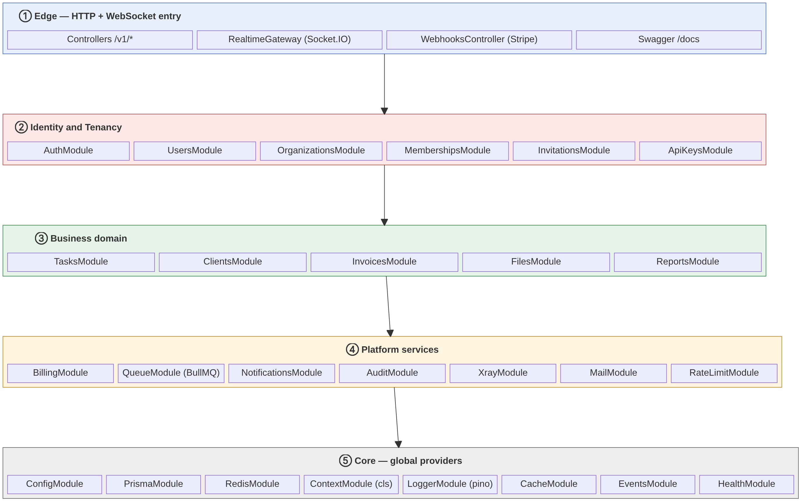

Dependencies only point **downward** (Edge → Identity/Tenancy → Domain → Platform → Core). Cross-module side effects (audit, notifications, X-ray) go through **domain events**, not direct imports, which keeps the graph acyclic.

| Layer | Modules | Notes |
|---|---|---|
| **Edge** | Controllers, `RealtimeGateway`, `WebhooksController`, Swagger | Thin: validation, auth, mapping |
| **Identity & tenancy** | Auth, Users, Organizations, Memberships, Invitations, ApiKeys | Who you are, which org you act in, what you may do |
| **Domain** | Tasks, Clients, Invoices, Files, Reports | The (intentionally simple) product |
| **Platform** | Billing, Queue, Notifications, Audit, Xray, Mail, RateLimit | Reusable SaaS plumbing — the real portfolio content |
| **Core** | Config, Prisma, Redis, Context, Logger, Cache, Events, Health | `@Global()` providers |

### 4.1 Domain events
Services emit typed events after a successful commit:

```ts
// core/events/domain-events.ts
export type DomainEvent =
  | { type: 'task.created';      orgId: string; actor: Actor; taskId: string }
  | { type: 'task.assigned';     orgId: string; actor: Actor; taskId: string; assigneeId: string }
  | { type: 'invoice.sent';      orgId: string; actor: Actor; invoiceId: string }
  | { type: 'member.invited';    orgId: string; actor: Actor; email: string; role: Role }
  | { type: 'subscription.changed'; orgId: string; plan: Plan; status: SubStatus };
```

Listeners: `AuditListener` (writes `AuditLog`), `NotificationListener` (creates `Notification` + WS push), `XrayListener` (emits X-ray event). Adding a new side effect = adding a listener, never editing the service.

> **Why EventEmitter2 and not a message broker?** In-process events are synchronous-ish, free, and enough for a monolith. Anything slow or that must survive a crash goes to BullMQ instead. That split ("events for fan-out, queues for durable work") is a good line to say in interviews.

---

## 5. Request lifecycle

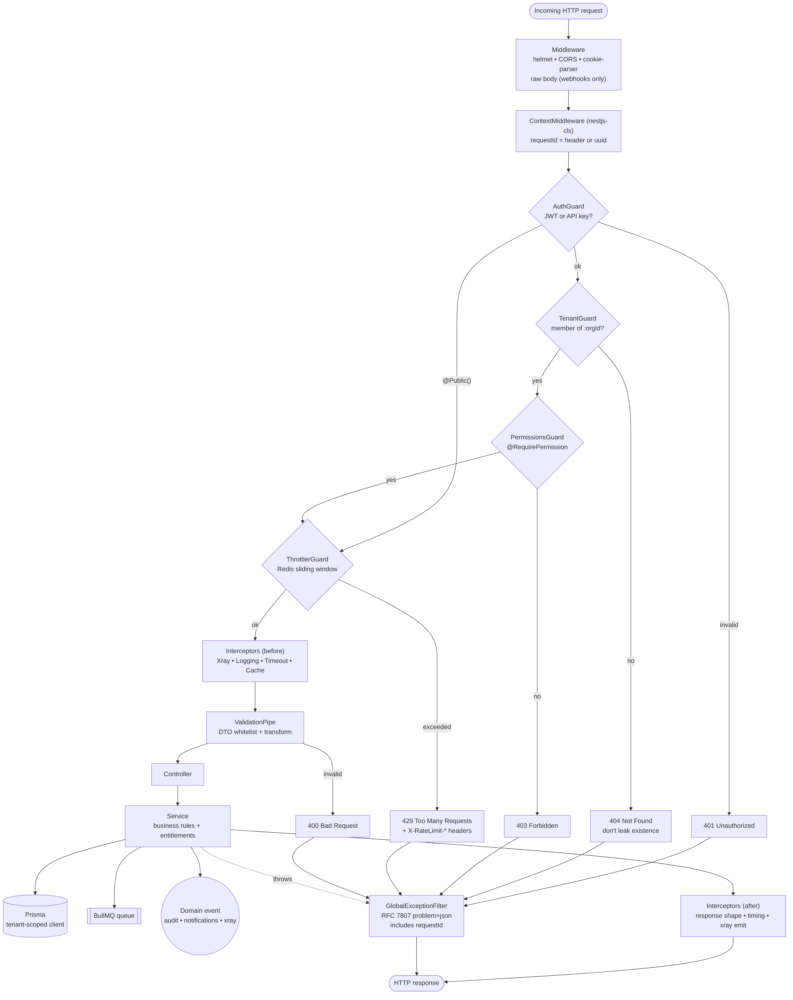

Order of execution in NestJS and what each step does here:

| # | Stage | Implementation | Purpose |
|---|---|---|---|
| 1 | Middleware | `helmet`, CORS allowlist, `cookie-parser`, `express.raw()` **only** on `/v1/webhooks/stripe` | Security headers, cookies, raw body for signature checks |
| 2 | Context | `nestjs-cls` middleware | Creates per-request store: `requestId` (from `X-Request-Id` or new UUID), later `userId`, `orgId`, `actor` |
| 3 | `AuthGuard` (global) | Accepts `Authorization: Bearer <jwt>` **or** `Authorization: Bearer sk_...` / `X-API-Key`; skips if `@Public()` | Identifies the caller as `USER` or `API_KEY` |
| 4 | `TenantGuard` | For routes under `/v1/orgs/:orgId/*`: checks membership (user) or key ownership (API key); stores `orgId` + `role` in CLS | Tenant isolation at the edge |
| 5 | `PermissionsGuard` | Reads `@RequirePermission('invoice:send')`, checks role → permission map | RBAC |
| 6 | `ThrottlerGuard` | `@nestjs/throttler` + Redis storage; different limits per tracker (IP / user / API key) | Abuse protection, emits X-ray `ratelimit.blocked` |
| 7 | Interceptors | `XrayInterceptor`, `LoggingInterceptor`, `TimeoutInterceptor` (10 s), optional `CacheInterceptor` | Cross-cutting before/after logic |
| 8 | `ValidationPipe` (global) | `whitelist`, `forbidNonWhitelisted`, `transform` | Reject unknown fields, coerce types |
| 9 | Controller → Service | Business logic, Prisma transaction, enqueue jobs, emit events | |
| 10 | `GlobalExceptionFilter` | Maps everything to RFC 7807 `application/problem+json` | Consistent errors with `requestId` |

> **Why return 404 (not 403) when you're not a member of an org?** It avoids confirming that an org ID exists. 403 is used when you *are* a member but lack the permission.

---

## 6. Data model

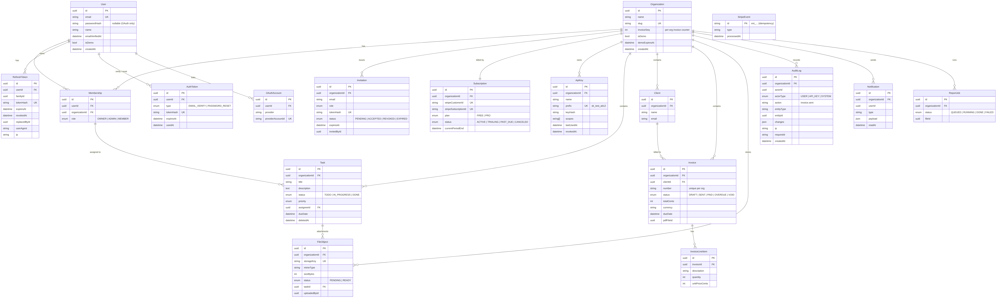

### 6.1 Modelling rules
- **UUID v7** (or `cuid2`) primary keys: not guessable, sortable by time. Never expose auto-increment IDs.
- **Every tenant-owned table has `organizationId`**, a composite index starting with it (e.g. `@@index([organizationId, status, createdAt])`), and FK `onDelete: Cascade` so deleting an org (including demo orgs) cleans up.
- **Money as integer cents** (`totalCents Int`) + `currency` (ISO 4217). Never floats.
- **Soft delete** (`deletedAt`) only where users expect "undo" (tasks, invoices). Hard delete elsewhere.
- **Secrets are never stored in plaintext:** passwords (argon2id), refresh tokens / verify / reset / invite tokens / API keys (SHA-256 of high-entropy random values).
- **Timestamps** `createdAt`, `updatedAt` on every table; all times stored in UTC.
- **Invoice numbers** unique per org: `@@unique([organizationId, number])`, generated inside a transaction from a per-org counter (`Organization.invoiceSeq`) to avoid races.

### 6.2 Key tables (summary)

| Table | Purpose | Notable constraints / indexes |
|---|---|---|
| `User` | Global identity (one user, many orgs) | `email` unique (lower-cased), `isDemo` |
| `OAuthAccount` | Google link | `@@unique([provider, providerAccountId])` |
| `RefreshToken` | Rotating refresh tokens | `tokenHash` unique, `familyId` index |
| `AuthToken` | Email verify & password reset | `tokenHash` unique, `expiresAt`, single-use `usedAt` |
| `Organization` | Tenant | `slug` unique, `isDemo`, `demoExpiresAt` index |
| `Membership` | User ↔ Org + role | `@@unique([userId, organizationId])` |
| `Invitation` | Pending invites | one PENDING invite per email per org (partial unique index); `tokenHash` unique |
| `Subscription` | Local mirror of Stripe state | One per org |
| `StripeEvent` | Webhook idempotency | PK = Stripe `evt_` id |
| `ApiKey` | Public API credentials | `prefix` unique, `keyHash`, `scopes[]`, `revokedAt` |
| `Task`, `Client`, `Invoice`, `InvoiceLineItem` | Product domain | Tenant indexes |
| `FileObject` | Metadata for S3 objects | `storageKey` unique, `status` |
| `AuditLog` | Append-only activity history | `@@index([organizationId, createdAt])`, `@@index([entityType, entityId])` |
| `Notification` | In-app notifications | `@@index([userId, readAt])` |
| `ReportJob` | Async report status | `status`, `fileId` |

The Prisma schema itself is the first coding step of Phase 1; the ERD above is its blueprint.

> **As built (Milestone 2):** [`prisma/schema.prisma`](../prisma/schema.prisma) implements the ERD as 18 tables and 11 enums. Beyond what Prisma can express, the first migration adds database-level `CHECK` constraints (lower-case emails, non-negative money, positive quantities, ISO-4217 currency, progress 0-100) and a partial unique index (one `PENDING` invitation per org + email). These are exercised by the integration suite against a real Postgres. Additions to the ERD: `updatedAt` on every mutable table, `Notification.userId` is a real foreign key, and `ReportJob` gained `type`, `params`, `progress`, `error` and `requestedById`.
>
> **Known limitation, deliberately deferred:** foreign keys such as `Task.assigneeId → Membership` and `Invoice.clientId → Client` guarantee the target exists, but not that it belongs to the *same organisation*. Closing that at the database level needs composite foreign keys `(organizationId, id)`, which Prisma cannot combine with `ON DELETE SET NULL` on a nullable column. Same-org integrity is therefore enforced in services and by the tenant-scoped Prisma extension (Milestone 5), and verified by the tenant-isolation test suite (Milestone 19). `AuditLog` append-only enforcement (denying `UPDATE`/`DELETE` to the app role) is deferred to Milestone 18, because a blanket trigger would also block the intended cascade delete of expired demo orgs.
>
> **Update (Milestone 6): the same-organisation limitation is now closed at the data layer.** `src/core/prisma/tenant-client.ts` wraps the database client; before any write that stores a reference listed in `TENANT_REFERENCES` (`Invoice.clientId`, `Task.assigneeId`/`createdById`, `InvoiceLineItem.invoiceId`, `FileObject.taskId`, ...) it verifies the target is in the caller's organisation, and a test compares that list with `schema.prisma` so a new foreign key cannot be missed. The foreign key still only proves existence; the data layer proves ownership. `Task` gained `createdById` (migration `task_created_by`) so a MEMBER can manage "their own" tasks, and `Client.name` uses an ICU collation (migration `client_name_collation`) so A–Z ordering ignores case.

---

## 7. Authentication

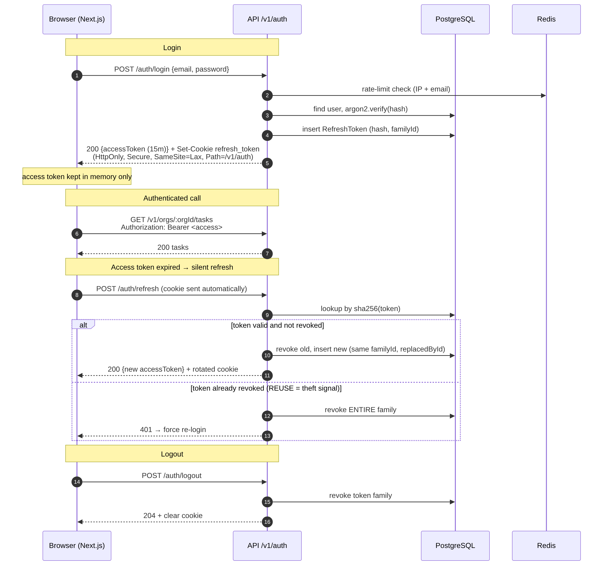

### 7.1 Token strategy

| Token | Format | Lifetime | Stored where | Why |
|---|---|---|---|---|
| **Access token** | JWT (HS256, or RS256 later) with `sub`, `sid`, `isDemo`; **no roles** in it | 15 min | Frontend memory only | Short-lived; roles are looked up per org so a demotion takes effect immediately |
| **Refresh token** | 256-bit random, base64url | 7 days (sliding), 30 days absolute | `HttpOnly; Secure; SameSite=Lax; Path=/v1/auth` cookie; **SHA-256 hash** in DB | Not readable by JS → XSS can't steal it |

**Rotation with reuse detection:** each refresh issues a new token in the same `familyId` and revokes the old one. If a *revoked* token is presented, someone copied it → revoke the whole family and force re-login. This is the "OAuth 2.0 Security BCP" pattern and a strong interview talking point.

> **Why not put the access token in a cookie too?** You could, but then every mutating endpoint needs CSRF protection. Bearer-in-memory + refresh-in-cookie (scoped to `/v1/auth` only) limits the CSRF surface to the refresh/logout endpoints, which are protected by `SameSite` + an `Origin` header check.

### 7.2 Endpoints (`/v1/auth`)

| Method & path | Notes |
|---|---|
| `POST /register` | Creates user (unverified), sends verify email via queue; returns tokens (or require verify first — D4) |
| `POST /login` | Rate limited 5/min per IP+email; generic error message for wrong email *or* password |
| `POST /refresh` | Rotation as above |
| `POST /logout` | Revokes family, clears cookie |
| `POST /logout-all` | Revokes all families for the user |
| `GET /google` → `GET /google/callback` | `passport-google-oauth20`; `state` param for CSRF; links to existing user **only if Google says `email_verified`**; then redirects to web with a short-lived one-time code exchanged for tokens (never put tokens in the URL) |
| `POST /verify-email` `{token}` | Single use, 24 h expiry |
| `POST /resend-verification` | Rate limited |
| `POST /forgot-password` `{email}` | **Always 202** whether or not the email exists (no account enumeration) |
| `POST /reset-password` `{token, newPassword}` | 1 h expiry, single use, revokes all refresh tokens |
| `POST /demo` | See §18 |
| `GET /me` | Current user + memberships (org list with role) |

> **As built (Milestone 3):** everything in §7.1–7.3 is implemented except Google sign-in and `POST /demo` (Google needs OAuth credentials, so it moves to a later milestone; `/demo` is Milestone 8). Decisions taken where this document offered a choice:
> - **D4:** `POST /register` signs the user in immediately; an unverified user can use the app. Verification will gate inviting people and billing (enforced when those features land).
> - **Email:** sent through a small provider adapter (SMTP → Mailpit in development, Resend over HTTPS in production). Delivery runs in a background task so it never slows or fails a request and cannot leak whether an address exists. Milestone 10 moves it onto the BullMQ `email` queue without changing callers.
> - **Passwords:** argon2id from Node's built-in `crypto` (no native add-on), stored as a PHC string so parameters can be raised later (`PASSWORD_HASH_*`).
> - **No hard-coded tunables:** link lifetimes, hashing cost, every rate limit and the infrastructure timeouts are environment settings with validated defaults (see README, "Configuration"). Routes name a rate-limit *policy* (`@RateLimit('credentials')`); the numbers are looked up from config per request.
> - **Access tokens are stateless:** after logout or a password reset an already-issued access token stays valid until it expires (15 min). Refresh tokens, which mint new ones, are revoked immediately. A per-session denylist is the upgrade path if that window ever matters.
> - **Rate limits** (Redis, shared across instances): login and forgot-password 5/min per IP + email, register 10/hour per IP, refresh 30/min, everything else 100/min per IP. If Redis is down the limiter fails open and logs, rather than locking everyone out.
> - **CSRF:** refresh and logout reject any request whose `Origin` is not the web app (requests with no `Origin`, such as curl, are allowed).
> - **Known trade-off:** `POST /register` answers 409 for an existing email, which reveals that the address is registered. The alternative (always 201 plus an email) is worse for users; the registration limit bounds how fast it can be probed.
> - Reusing a retired refresh token revokes only that session (token family), not the user's other devices. Two simultaneous refreshes with the same token count as a replay: one wins, the other signs the session out.

### 7.3 Password handling
- `argon2id` (memory 19 MiB, iterations 2 — OWASP baseline). Never bcrypt with low cost; never your own crypto.
- Policy: min 10 characters; optional check against the HaveIBeenPwned range API later.
- Compare tokens with `crypto.timingSafeEqual` where you compare raw values.

---

## 8. Multi-tenancy and RBAC

### 8.1 Tenancy model
**Shared database, shared schema, `organizationId` column** on every tenant-owned row. This is what most startups do until they're much bigger; schema-per-tenant or DB-per-tenant adds migration pain for no benefit at this scale.

**Tenant resolution:** URL-based — `/v1/orgs/:orgId/tasks`. Explicit, cache-friendly, easy to read in logs and Swagger, and works the same for users and API keys. (Alternative: `X-Org-Id` header — see D2.)

### 8.2 Defence in depth against cross-tenant leaks
1. **Edge:** `TenantGuard` verifies membership and stores `orgId` in CLS.
2. **Data access:** a **Prisma client extension** reads `orgId` from CLS and automatically adds `where: { organizationId }` to `find*/update*/delete*/count` and sets it on `create` for tenant models. A missing tenant context on a tenant model **throws** instead of returning everything.
3. **Tests:** a dedicated e2e suite tries to read/update org B's resources with org A's credentials for every endpoint (§21).
4. **Optional hardening (later):** Postgres Row-Level Security with `SET app.current_org` per transaction. Mention as "next step" in calls; not needed for the demo.

> **Common mistake to avoid:** `findUnique({ where: { id } })` followed by an ownership check in code. It works until someone forgets the check. Use `findFirst({ where: { id, organizationId } })` (the extension does this for you) so a foreign ID simply returns "not found".

> **As built (Milestone 4):** `TenantGuard` and `PermissionsGuard` are global guards, registered after authentication. Any route with an `:orgId` path parameter is checked: the caller's membership (and current role) is read from the database on every request, a non-member or malformed id gets the same `404`, and the result is stored in the request context. A tenant route that declares no `@RequirePermission` is refused (fail closed). The permission table is `src/modules/tenancy/permissions.ts`, compared cell by cell with §8.3 by a unit test. Still to come: the Prisma tenant extension (§8.2 point 2) and the isolation suite.
> - **Membership changes** run in one transaction that first locks the organisation row, re-reads the caller under the lock and re-checks their permission against the role they hold *now*. That closes the window between the guard's check and the change, and makes "at least one owner" safe under concurrency.
> - **Ownership transfer** is two steps: the owner promotes the successor to OWNER, who can then step the old owner down (nobody can change their own role). The sole owner cannot leave.
> - **Quota:** a person may own `MAX_ORGS_PER_USER` organisations (default 5); belonging to others does not count. Checked under a lock on the user row. Demo accounts cannot create organisations.
> - **Slugs** are readable plus a random 6-hex suffix (`acme-studio-3fa91c`), unique without a lookup; they never change when the organisation is renamed.
> - Adding people to an organisation arrives with invitations (§8.4); until then an organisation has only its creator.

> **As built (Milestone 6): the data layer (§8.2 point 2).** `TenantPrismaService.client` is a Prisma client extension that reads the organisation from the request context and ANDs `organizationId` into every `find*`/`count`/`aggregate`/`groupBy`/`update*`/`delete*`, stamps it on `create*` (refusing a different one, and the `organization: { connect }` form), and refuses to run at all when there is no organisation in context. The rules are a pure function (`tenant-scope.ts`) tested exhaustively; a test reads `schema.prisma` and fails if a table is not classified as tenant-owned, line-item-owned or global. Global tables (users, tokens) and raw SQL are unavailable on this client, only interactive transactions are allowed, and foreign-key checks run on the transaction's own connection (a check on a second connection deadlocked the pool under a burst of concurrent requests, found by a test). Domain modules may import only this client, enforced by `architecture.spec.ts`; identity code (auth, tenancy guards, memberships, invitations) keeps using the unscoped `PrismaService` because it legitimately works across organisations. Background jobs run inside `RequestContextService.runWithTenant()`. The isolation suite (`test/tenant-isolation.int-spec.ts`) attacks every endpoint from a second organisation, by URL, by id and by ids smuggled in bodies, and checks the victim's data is unchanged.

### 8.3 Roles and permissions

| Permission | OWNER | ADMIN | MEMBER |
|---|:--:|:--:|:--:|
| `org:update`, `org:delete` | ✅ / ✅ | ✅ / ❌ | ❌ |
| `billing:manage` | ✅ | ❌ | ❌ |
| `member:invite`, `member:remove`, `member:change-role` | ✅ | ✅ (cannot touch OWNER) | ❌ |
| `apikey:manage` | ✅ | ✅ | ❌ |
| `task:create`, `task:update` | ✅ | ✅ | ✅ (update own/assigned only) |
| `task:delete` | ✅ | ✅ | own only |
| `client:*`, `invoice:create`, `invoice:update` | ✅ | ✅ | ❌ (read-only) |
| `invoice:send`, `invoice:void` | ✅ | ✅ | ❌ |
| `audit:read` | ✅ | ✅ | ❌ |
| `report:generate` | ✅ | ✅ | ✅ |

- Permissions live in `packages/shared/permissions.ts` so the UI hides buttons using the **same** map the backend enforces.
- Guards answer *"may this role ever do this?"*; services answer *"may this user do this to this specific record?"* (e.g. a MEMBER editing their own task).
- Invariants enforced in the service: an org always has ≥ 1 OWNER; only an OWNER can transfer ownership; you can't change your own role.

### 8.4 Invitations
1. ADMIN/OWNER `POST /v1/orgs/:orgId/invitations {email, role}` → row with `tokenHash`, 7-day expiry → email job.
2. Link: `app.yourdomain.com/invite/accept?token=…`.
3. `POST /v1/invitations/accept {token}`: if logged in, email must match; if not, sign-up flow pre-fills email. Creates `Membership` in a transaction, marks invite `ACCEPTED`.
4. Resend / revoke endpoints; duplicate pending invite for the same email is rejected (409).
5. Plan limit check (FREE = 3 seats) via entitlements (§10.4).

> **As built (Milestone 5):** all of §8.4 is implemented; `POST /v1/invitations/preview` (public) was added so the sign-up page can pre-fill the invited email. Decisions:
> - **Seats** are members plus *unexpired* pending invitations, so an invitation holds its seat until it is accepted, revoked or expires. Limits are environment settings (`FREE_PLAN_MAX_SEATS` 3, `PRO_PLAN_MAX_SEATS` 25); going over answers `402 PLAN_LIMIT_EXCEEDED` with an `upgradeUrl`. `EntitlementsService` (§10.4) owns this; Stripe will change which plan an organisation is on, not the logic. The plan is read from the database for now; the Redis cache in §10.4 arrives with billing.
> - **Inviting needs a verified email** (decision D4) and is refused for demo accounts. Only ADMIN and MEMBER can be invited; ownership is handed over through the role-change endpoint.
> - **One message for every bad token** (unknown, expired, revoked, already used, or addressed to a different account), so the response never reveals whether an address was invited.
> - **Concurrency:** sending, re-sending and revoking run under a lock on the organisation row; accepting is an atomic `status = PENDING → ACCEPTED` claim. An expired invitation keeps the "one pending per email" slot until marked, so creating a new one first marks stale ones `EXPIRED`.
> - Accepting does not mark the email as verified (the user verifies separately). If a plan is downgraded below the current team size, existing members stay; only new invitations are blocked.

---

## 9. Core domain: tasks, clients, invoices

Kept deliberately small so effort goes into the platform.

| Resource | Endpoints (under `/v1/orgs/:orgId`) | Interesting backend bits |
|---|---|---|
| **Tasks** | `GET/POST /tasks`, `GET/PATCH/DELETE /tasks/:id`, `POST /tasks/:id/attachments` | Cursor pagination, filtering (`status`, `assigneeId`, `q`), assignment → notification + WS push |
| **Clients** | CRUD `/clients` | Unique email per org |
| **Invoices** | CRUD `/invoices`, `POST /invoices/:id/send`, `POST /invoices/:id/void`, `GET /invoices/:id/pdf` | State machine (below), per-org numbering, PDF generated in a job, `Idempotency-Key` header on `POST` |
| **Dashboard** | `GET /dashboard/stats` | Cached in Redis 60 s, invalidated by events → great X-ray "cache hit" demo |
| **Reports** | `POST /reports {type, range}` → 202 + `reportJobId`; `GET /reports/:id` | Async job, progress over WS, file in S3 |

**Invoice state machine**

```
DRAFT ──send──▶ SENT ──mark paid──▶ PAID
  │               │
  │               └──(cron: dueDate passed)──▶ OVERDUE ──mark paid──▶ PAID
  └──void──▶ VOID ◀──void── SENT / OVERDUE
```
Only `DRAFT` invoices are editable. Illegal transitions throw `InvalidStateTransitionError` → 409.

> **As built (Milestone 6):** clients, tasks and invoices are implemented as described, except where noted. **Tasks:** attachments arrive with file uploads; MEMBERs may edit tasks they created or are assigned to, reassign only their own creations, and delete only their own creations (the design said "own/assigned"). **Invoices:** `pay` is a new endpoint (the diagram's "mark paid"); drafts are soft-deleted and anything sent is voided, never erased; the total is always computed by the server from integer-cent line items, and a total that does not fit 32 bits is refused; numbers come from `Organization.invoiceSeq` incremented inside the creating transaction, so they are unique and gap-free even under concurrent requests; every transition is an atomic `UPDATE ... WHERE status IN (...)`; sending needs a priced line item, defaults the due date to `INVOICE_DEFAULT_TERMS_DAYS`, and emails the client (not from demo organisations). **Not yet built:** `GET /invoices/:id/pdf`, the `Idempotency-Key` header, the SENT → OVERDUE cron (all need the job queue and Redis cache milestones), dashboard stats and reports. **Pagination** is keyset (`{ data, nextCursor }`) with the sort column plus id as the cursor. Searches escape `%` and `_`.

**API conventions**
- Pagination: cursor-based `?limit=20&cursor=<opaque>` → `{ data, nextCursor }`. Offset pagination is easy but breaks with inserts; mention why.
- Sorting: `?sort=-createdAt`. Filtering via explicit DTO fields (never pass query objects straight to Prisma).
- `PATCH` for partial updates; `PUT` not used.
- `Idempotency-Key` on money-ish POSTs: key + response stored in Redis for 24 h; replay returns the stored response.

---

## 10. Payments: Stripe subscriptions and webhooks

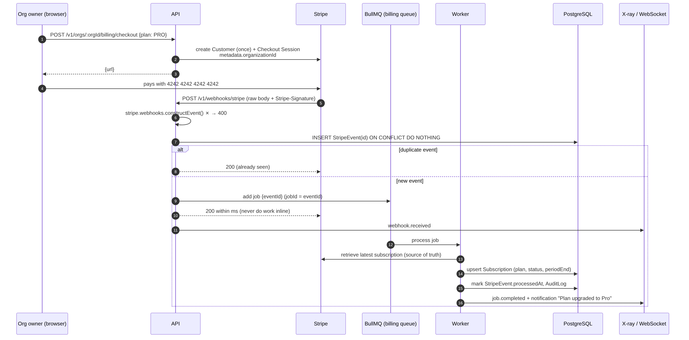

### 10.1 Plans

| Plan | Price (test) | Limits |
|---|---|---|
| FREE | $0 | 3 members, 50 tasks, 5 invoices/month, 10 MB uploads, 60 API req/min |
| PRO | $19/month | 25 members, unlimited tasks/invoices, 100 MB uploads, 600 API req/min |

Prices live in Stripe; the app maps `priceId → plan` via env config.

### 10.2 Flows
- **Upgrade:** `POST /billing/checkout` → Stripe Checkout Session (`mode: subscription`, `client_reference_id = orgId`, `metadata.organizationId`) → redirect.
- **Manage / cancel:** `POST /billing/portal` → Stripe Customer Portal URL.
- **State:** `GET /billing/subscription` reads the **local** `Subscription` row (fast; Stripe is not called on every request).

### 10.3 Webhook handling rules (the part founders care about)
1. **Raw body + signature verification** with `STRIPE_WEBHOOK_SECRET`. Body parsing must be disabled for this route or verification fails — a classic NestJS gotcha (`rawBody: true` in `NestFactory.create`).
2. **Idempotency:** insert `StripeEvent(id)`; if it already exists, return 200 and stop. Stripe retries and can deliver duplicates.
3. **Acknowledge fast:** enqueue `billing` job with `jobId = event.id` (BullMQ dedupes), return 200. Never call Stripe or send emails inline in the webhook.
4. **Out-of-order safe:** the processor re-fetches the subscription from Stripe and upserts the latest state rather than trusting the event payload order.
5. **Handled events:** `checkout.session.completed`, `customer.subscription.created|updated|deleted`, `invoice.payment_failed` (→ `PAST_DUE` + email), `invoice.paid`.
6. Local dev: `stripe listen --forward-to localhost:3000/v1/webhooks/stripe` (container in docker-compose).

### 10.4 Entitlements
`EntitlementsService.assert(orgId, 'members' | 'tasks' | 'uploadBytes' | ...)` is called in services before creating limited resources. Throws `PlanLimitExceededError` → 402 with an `upgradeUrl`. The current plan is cached in Redis and invalidated on `subscription.changed`.

---

## 11. Background jobs (BullMQ)

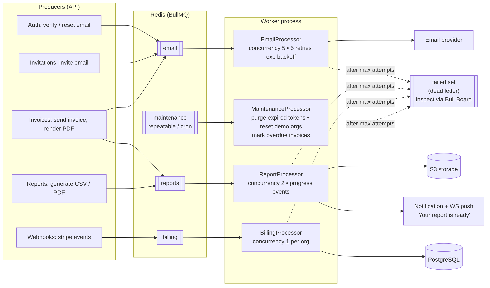

### 11.1 Queues

| Queue | Jobs | Concurrency | Retry policy | Notes |
|---|---|---|---|---|
| `email` | `verify-email`, `reset-password`, `invite`, `invoice-sent`, `payment-failed` | 5 | 5 attempts, exponential backoff from 10 s | Demo orgs: routed to in-app outbox instead of real send |
| `reports` | `generate-report`, `render-invoice-pdf` | 2 | 3 attempts | Reports progress via `job.updateProgress()` → WS |
| `billing` | `stripe-event` | 1 (ordering) | 8 attempts | `jobId = stripeEventId` |
| `maintenance` | `purge-expired-tokens` (daily), `cleanup-demo-orgs` (hourly), `mark-overdue-invoices` (hourly), `cleanup-pending-files` (daily) | 1 | 3 attempts | BullMQ repeatable jobs (Job Schedulers) |

### 11.2 Rules
- **Job payloads carry IDs, not objects** (`{ invoiceId, orgId, requestId }`). The worker reloads fresh data; payloads stay small and never contain secrets.
- **Every processor is idempotent** (safe to run twice): e.g. check `invoice.pdfFileId` before rendering again.
- **Propagate `requestId`** into job data so X-ray and logs connect "the click" to "the email sent 2 s later".
- **Failed jobs** stay in BullMQ's failed set (our dead-letter queue). Expose **Bull Board** at `/admin/queues` behind basic auth (disabled for demo users) — very effective to show on a call.
- `removeOnComplete: { age: 3600, count: 1000 }` to stop Redis growing forever.
- Graceful shutdown: `app.enableShutdownHooks()`; workers close and finish in-flight jobs on SIGTERM.

---

## 12. Real-time (WebSockets)

- **Socket.IO** via `@nestjs/websockets` + `@nestjs/platform-socket.io`; **`@socket.io/redis-adapter`** so multiple API instances (and the worker, via Redis emitter) can push to the same rooms.
- **Auth on handshake:** client sends the access token in `auth: { token }`; the gateway verifies it in `handleConnection` and disconnects on failure. Token expiry → client reconnects with a refreshed token.
- **Rooms**

| Room | Joined when | Receives |
|---|---|---|
| `user:{userId}` | On connect | Personal notifications |
| `org:{orgId}` | Client emits `org:join` and membership is verified | Task/invoice changes, report progress |
| `xray:{orgId}` | Client opens the X-ray panel (permission checked) | X-ray events (§17) |

- **Server → client events** (typed in `packages/shared/ws-events.ts`): `notification.created`, `task.updated`, `report.progress`, `report.ready`, `xray.event`, `xray.replay`.
- Notifications are **persisted first, pushed second** — if the socket is down the user still sees them on next load (`GET /notifications`).
- The worker pushes using `@socket.io/redis-emitter` (no HTTP server needed in the worker).

---

## 13. File uploads

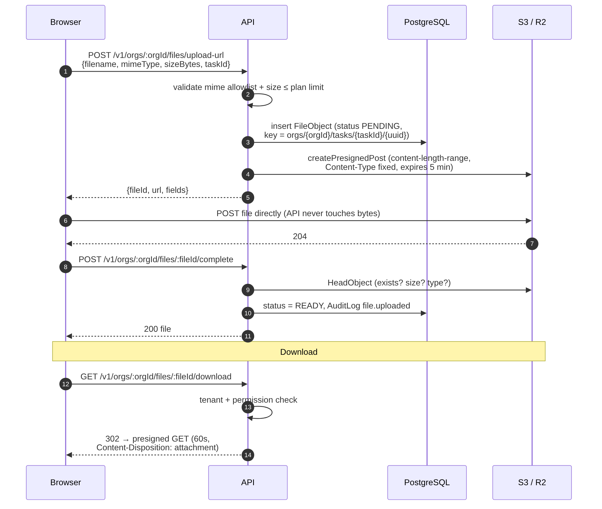

- **Direct-to-storage uploads** with presigned **POST** (not PUT) because POST policies can enforce `content-length-range` and an exact `Content-Type`. The API never streams file bytes → no memory spikes, no request timeouts.
- **Storage key layout:** `orgs/{orgId}/tasks/{taskId}/{uuid}-{sanitisedName}`. Tenant prefix makes per-org cleanup and policies trivial.
- **Two-phase commit:** `PENDING` row → upload → `complete` call runs `HeadObject` to confirm size/type → `READY`. A daily job deletes `PENDING` rows and objects older than 24 h.
- **Allowlist** MIME types (images, PDF, CSV, docx, xlsx); reject SVG/HTML (stored XSS). Downloads always use `Content-Disposition: attachment`.
- **Downloads:** API checks tenant + permission, then 302 to a 60-second presigned GET. Bucket stays **private**.
- Quota per plan via entitlements (§10.4).
- Provider abstraction: `StorageService` wraps `@aws-sdk/client-s3`; endpoint/region/credentials from env → works with R2, MinIO, S3, Backblaze unchanged.

---

## 14. Public API

### 14.1 API keys
- **Format:** `sk_test_` + 8-char public prefix + `_` + 32-byte random secret (base62), e.g. `sk_test_ab12cd34_9fK…`. The prefix is stored in plaintext for lookup and display; the full key is stored as SHA-256 (fast hash is fine because the secret is high-entropy, unlike passwords).
- Shown **once** at creation. List view shows name, prefix, scopes, `lastUsedAt`.
- **Scopes:** `tasks:read`, `tasks:write`, `invoices:read`, `invoices:write`, `clients:read`. `PermissionsGuard` checks scopes for `API_KEY` actors and roles for `USER` actors — one guard, two strategies.
- Key belongs to an org; `TenantGuard` rejects if `:orgId` ≠ key's org.
- `lastUsedAt` updated at most once a minute (Redis debounce) to avoid a DB write per request.
- Revocation is immediate (cached key lookups are invalidated on revoke).

### 14.2 Rate limiting

| Tracker | Default limit | Applies to |
|---|---|---|
| IP | 100 req/min | Unauthenticated routes |
| IP + email | 5 req/min | `/auth/login`, `/auth/forgot-password` |
| User | 300 req/min | Dashboard JWT traffic |
| API key | plan-based (60 / 600 req/min) | Public API |
| IP | 3 / hour | `/auth/demo` |

- `@nestjs/throttler` with a Redis storage (`@nest-lab/throttler-storage-redis`) so limits hold across instances.
- Responses include `X-RateLimit-Limit`, `X-RateLimit-Remaining`, `X-RateLimit-Reset`, and `Retry-After` on 429.
- Each 429 emits an X-ray `ratelimit.blocked` event; the panel has a **"Spam this endpoint"** button that fires 20 requests so founders can watch rate limiting happen.

### 14.3 Versioning
- **URI versioning** (`app.enableVersioning({ type: VersioningType.URI })`) → `/v1/...`. Clear in docs and logs.
- Breaking changes ship as `/v2` controllers alongside v1; v1 responses get `Deprecation` and `Sunset` headers when retired.

### 14.4 Swagger / OpenAPI
- `@nestjs/swagger` with the CLI plugin (auto-reads DTO types, less decorator noise).
- Served at `/docs` (Swagger UI) and `/docs-json`. Two security schemes: `bearer` (JWT) and `apiKey`.
- Response DTOs and error schema (`ProblemDetails`) documented; examples on key endpoints.
- The Next.js API client is **generated** from `/docs-json` (`openapi-typescript`) → frontend and backend can't drift.

---

## 15. Reliability

### 15.1 Validation
Global `ValidationPipe({ whitelist: true, forbidNonWhitelisted: true, transform: true })`; `class-validator` DTOs; env vars validated at boot with zod (app refuses to start on a bad config — fail fast).

### 15.2 Error handling
- Domain errors (`NotFoundError`, `PlanLimitExceededError`, `InvalidStateTransitionError`, `ConflictError`) are plain classes thrown by services; the global filter maps them to HTTP. Services stay HTTP-agnostic.
- Prisma errors mapped: `P2002` → 409 Conflict, `P2025` → 404.
- Response shape (RFC 7807):

```json
{
  "type": "https://docs.yourdomain.com/errors/plan-limit-exceeded",
  "title": "Plan limit exceeded",
  "status": 402,
  "detail": "FREE plan allows 3 members. Upgrade to add more.",
  "code": "PLAN_LIMIT_EXCEEDED",
  "requestId": "01JC9Z…",
  "errors": [ { "field": "email", "message": "must be an email" } ]
}
```
- 5xx: generic message to the client, full stack in logs (and Sentry if enabled). Never leak stack traces or SQL.

### 15.3 Structured logging
- `nestjs-pino`: JSON logs in prod, pretty in dev. Every line carries `requestId`, `userId`, `orgId`, `route`, `durationMs`.
- **Redaction** paths: `req.headers.authorization`, `req.headers.cookie`, `*.password`, `*.token`, `*.apiKey`.
- Log levels: `info` per request, `warn` 4xx business errors worth noticing, `error` 5xx and job failures.

### 15.4 Health checks (`@nestjs/terminus`)

| Endpoint | Checks | Used by |
|---|---|---|
| `GET /health/live` | Process up | Host restart policy |
| `GET /health/ready` | Postgres `SELECT 1`, Redis `PING`, (optional) queue backlog under threshold | Deploy smoke test, load balancer |

### 15.5 Caching
- **Cache-aside in Redis** via a small `CacheService.wrap(key, ttl, fn)` (explicit beats magic interceptors; also the place the X-ray hit/miss event is emitted).
- Keys namespaced by tenant: `org:{orgId}:dashboard:stats`, `org:{orgId}:plan`.
- Invalidation on domain events (`task.*`, `invoice.*` → delete `org:{orgId}:dashboard:*`).
- Never cache per-user permission-sensitive responses under a shared key.

### 15.6 Other reliability details
- `TimeoutInterceptor` (10 s) so hung requests fail cleanly.
- Prisma `$transaction` for multi-row writes (accepting invite, creating invoice + lines).
- Graceful shutdown hooks for Prisma, Redis, BullMQ, Socket.IO.

---

## 16. Audit log

**What:** an append-only record of *who did what, when, from where* — a feature B2B buyers ask for early.

| Field | Example |
|---|---|
| `actorType` / `actorId` | `USER` / user id · `API_KEY` / key id · `SYSTEM` (cron, webhook) |
| `action` | `invoice.sent`, `member.role_changed`, `apikey.created`, `subscription.updated` |
| `entityType` / `entityId` | `Invoice` / id |
| `changes` | `{ "status": ["DRAFT", "SENT"] }` (diff of changed fields only, sensitive fields excluded) |
| `ip`, `userAgent`, `requestId` | for forensics, links to logs and X-ray |

**How:**
- Services emit domain events; `AuditListener` writes the row. For security-critical actions (role change, API key creation, ownership transfer) the audit row is written **inside the same transaction** as the change so it can't be lost.
- Append-only: no update/delete endpoints; in the DB, the app role can be denied `UPDATE/DELETE` on `AuditLog` (nice hardening point).
- `GET /v1/orgs/:orgId/audit-logs?actorId=&action=&entityType=&from=&to=&cursor=` for ADMIN/OWNER; the UI shows "Ada changed Bola's role from Member to Admin · 2 min ago".
- Retention: 90 days on FREE, 1 year on PRO (maintenance job).

---

## 17. Backend X-ray panel

The differentiator. Goal: a non-technical founder clicks "Send invoice" and *sees* the backend work.

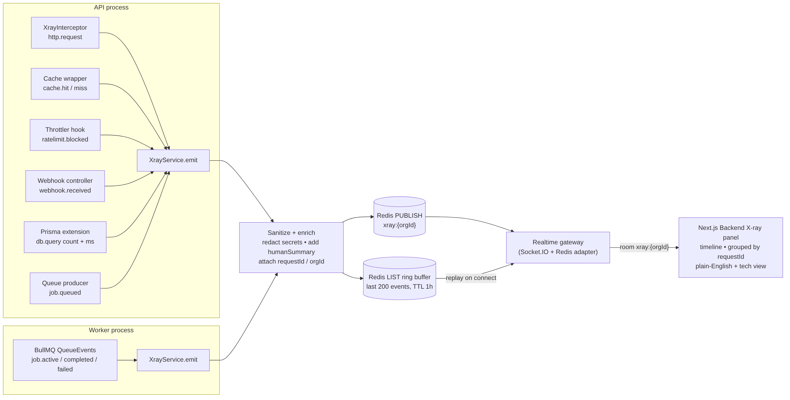

### 17.1 Event contract (`packages/shared/xray-events.ts`)

```ts
export interface XrayEvent {
  id: string;                 // uuid
  ts: number;                 // epoch ms
  orgId: string;
  requestId?: string;         // groups events from one click
  kind:
    | 'http.request'          // method, route, status, durationMs
    | 'auth.check'            // guard passed: role, permission
    | 'db.query'              // model, operation, durationMs (aggregated per request)
    | 'cache.hit' | 'cache.miss'
    | 'ratelimit.blocked'
    | 'job.queued' | 'job.active' | 'job.completed' | 'job.failed' | 'job.retry'
    | 'webhook.received' | 'webhook.duplicate'
    | 'ws.emit'
    | 'email.sent'
    | 'audit.recorded';
  severity: 'info' | 'success' | 'warn' | 'error';
  title: string;              // "Cache hit"
  humanSummary: string;       // "Dashboard served from memory in 2 ms (saved a database trip)"
  meta: Record<string, unknown>; // technical details for the "Developer view" toggle
}
```

### 17.2 Producers (where events come from)

| Source | Events |
|---|---|
| `XrayInterceptor` | `http.request` (after response, with status + duration) |
| Guards | `auth.check` (role + permission that allowed the call) |
| Prisma `$extends` query hook | `db.query` — counts and total ms per request, emitted once at end (not per query, to avoid noise) |
| `CacheService.wrap` | `cache.hit` / `cache.miss` with saved time |
| Throttler storage hook | `ratelimit.blocked` |
| Queue producer wrapper | `job.queued` |
| BullMQ `QueueEvents` (worker) | `job.active`, `job.completed` (with duration), `job.failed`, `job.retry` |
| Stripe webhook controller | `webhook.received`, `webhook.duplicate` (idempotency in action) |
| Realtime gateway | `ws.emit` |
| Audit listener | `audit.recorded` |

### 17.3 Transport
1. `XrayService.emit()` sanitises (drops headers, bodies, tokens; only allow-listed `meta` keys), enriches with `requestId`/`orgId` from CLS.
2. `PUBLISH xray:{orgId}` on Redis — works from both API and worker processes.
3. `LPUSH` + `LTRIM 0 199` + `EXPIRE 3600` on `xray:buffer:{orgId}` → when the panel opens it gets the last 200 events (`xray.replay`) so it is never empty.
4. The gateway subscribes (pattern `xray:*`) and forwards to room `xray:{orgId}`.
5. **Fire-and-forget**: X-ray failures are logged and swallowed; they must never break a real request. Emission is non-blocking.
6. **Kill switch:** `XRAY_ENABLED` env flag; per-org toggle. In production for real customers this would be off or restricted to admins.

### 17.4 Panel UX (frontend)
- Docked drawer on the right, open by default in demo mode.
- **Timeline grouped by `requestId`**: one card per click, expandable into its steps:
  `POST /invoices/123/send · 84 ms` → ✅ auth (Admin may `invoice:send`) → 🗄️ 3 DB queries (12 ms) → 📨 job queued: invoice email → 📝 audit recorded → ⚡ pushed to 2 teammates → *(2 s later)* ✅ job completed: email sent.
- **Two modes:** *Founder view* (`humanSummary`, icons) and *Developer view* (method, route, status, ms, job ids, JSON `meta`).
- **Live counters:** requests/min, cache hit rate, jobs in flight, rate-limit blocks.
- **"Try it" buttons** that trigger interesting backend behaviour on purpose:
  - *Spam this endpoint* → watch 429s.
  - *Generate report* → watch queued → active (progress %) → completed → notification.
  - *Simulate Stripe webhook twice* (demo-only endpoint calling the same handler with the same fake event id) → see `webhook.received` then `webhook.duplicate` — idempotency made visible.
  - *Load dashboard twice* → miss then hit.
  - *Fail a job* → watch retries with backoff, then dead-letter.

### 17.5 Why this design
- Uses real hooks in the real code path, not fake animations — it's honest and you can open the code on a call.
- Redis pub/sub is the simplest thing that works across two processes; at scale you'd swap it for OpenTelemetry traces (mention as evolution).

---

## 18. "Try demo" flow

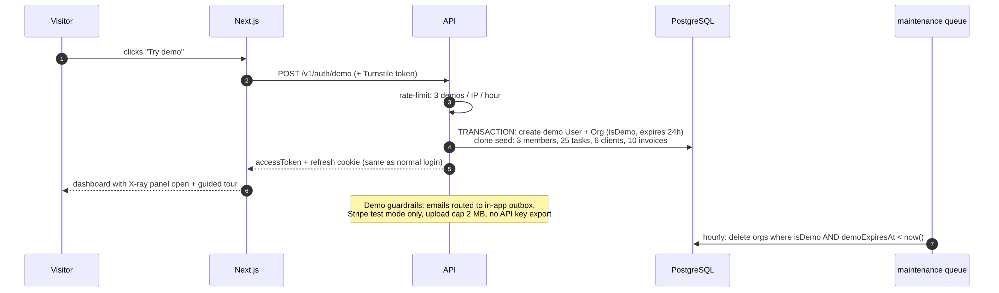

**Recommendation: one isolated sandbox org per visitor** (decision D3).

| Option | Pros | Cons |
|---|---|---|
| **Per-visitor sandbox (recommended)** | No vandalism; X-ray shows only *your* events; every visitor sees a clean, full dataset | Needs a seed-clone + cleanup job (~1 day of work) |
| Shared demo account | Trivial | Visitors delete data, change passwords, see each other's X-ray noise — looks broken on a sales call |

**Mechanics**
- `POST /v1/auth/demo` (Cloudflare Turnstile token + 3/hour/IP) creates a demo user `demo-{shortid}@demo.local`, an org `Acme Studio (demo)`, two fake teammates, ~25 tasks, 6 clients, 10 invoices in mixed states, a FREE subscription — all in one transaction from a seed template. Target < 500 ms.
- Returns normal tokens; the demo user can switch between OWNER and MEMBER (demo-only endpoint) to *feel* RBAC.
- **Guardrails:** emails go to an in-app "Outbox" view (no real sends); Stripe test checkout allowed; upload cap 2 MB; API keys can be created but only work for 24 h; no password change; Bull Board hidden.
- **Cleanup:** hourly maintenance job deletes orgs where `isDemo AND demoExpiresAt < now()` (cascade) and their S3 prefix.
- Frontend opens the dashboard with the X-ray panel open and a 4-step guided tour.

---

## 19. Decisions to confirm before building

Per our working agreement, these are the big calls. Each has a recommendation; confirm or change before the relevant phase.

| # | Decision | Recommendation | Alternatives | Needed by |
|---|---|---|---|---|
| **D1** | Repo layout | pnpm monorepo (`apps/api`, `apps/web`, `packages/shared`) | Two separate repos | Phase 1 start |
| **D2** | Tenant resolution | URL path `/v1/orgs/:orgId/...` | `X-Org-Id` header; subdomain per org | Phase 1 start |
| **D3** | Demo model | Per-visitor sandbox org, 24 h TTL | Shared demo account | Phase 1 end |
| **D4** | Email verification | Allow login unverified, but block inviting/billing until verified | Hard block until verified | Phase 1 |
| **D5** | Worker process | Separate service from Phase 2; in-process in Phase 1 | Always in-process | Phase 2 |
| **D6** | Hosting | Railway (API + worker + Postgres + Redis in one project) | Render, Fly.io; Neon for DB | Phase 1 deploy |
| **D7** | Storage | Cloudflare R2 (free egress, S3 API) | AWS S3, Backblaze B2 | Phase 2 |
| **D8** | Email provider | Resend | Postmark, SES | Phase 1 (verify/reset) |
| **D9** | Custom domain | Buy one (~$10/yr) for `app.` + `api.` | Next.js rewrite proxy | Phase 1 deploy |
| **D10** | ID type | UUID v7 | cuid2 | Phase 1 schema |

---

## 20. Security model

| Threat | Mitigation |
|---|---|
| Cross-tenant data access (IDOR) | `TenantGuard` + Prisma tenant extension + 404 on foreign IDs + isolation e2e tests |
| Stolen access token | 15 min lifetime, memory-only storage |
| Stolen refresh token | HttpOnly cookie, rotation, reuse detection → family revoke |
| XSS | React escaping, strict CSP from Next.js, no `dangerouslySetInnerHTML`, no SVG/HTML uploads, attachment disposition |
| CSRF | Bearer tokens for API; refresh cookie `SameSite=Lax`, path-scoped, `Origin` check |
| Brute force / credential stuffing | Per IP+email throttling on login/reset; generic errors; optional lockout after N failures |
| Account enumeration | Same response for existing/non-existing email on forgot-password and register conflicts handled gently |
| Webhook forgery / replay | Stripe signature verification, timestamp tolerance (SDK default 5 min), idempotency table |
| Leaked API key | Hashed at rest, shown once, scoped, revocable, prefix lets users identify which key leaked |
| Mass assignment | `whitelist` + `forbidNonWhitelisted`; explicit DTOs; never spread `req.body` into Prisma |
| Secrets in logs | Pino redaction; X-ray sanitiser allowlist |
| Misconfiguration | zod env validation at boot; `helmet`; CORS allowlist (`WEB_ORIGIN` only) |
| Dependency vulnerabilities | Dependabot, `pnpm audit`, Trivy image scan in CI |
| Abuse of demo | Turnstile, per-IP limits, quotas, 24 h TTL |
| Privilege escalation | Role invariants in service (≥1 OWNER, can't self-promote, ADMIN can't touch OWNER) |

Production basics: HTTPS only (HSTS), DB user without superuser rights, separate Stripe test/live keys, rotate `JWT_SECRET` via `kid` support later.

---

## 21. Testing strategy

| Level | Tool | What | Target |
|---|---|---|---|
| **Unit** | Vitest | Services with mocked repositories/Prisma: invoice state machine, permission map, token rotation logic, entitlements, X-ray sanitiser | Business logic ≥ 80 % |
| **Integration / e2e** | Vitest + Supertest against real Postgres + Redis (GitHub Actions service containers locally via docker-compose) | Full HTTP flows: register → verify → login → refresh; create org → invite → accept; CRUD; webhook idempotency (send same event twice); rate limiting returns 429 | All critical paths |
| **Tenant isolation suite** | Table-driven e2e | For every tenant route: org A user requests org B resource → 404; API key of org A on org B → 404/403 | 100 % of tenant routes |
| **Queue tests** | BullMQ with real Redis, processors called directly | Idempotency (run twice), retry behaviour | Each processor |
| **Contract** | OpenAPI snapshot | Fail CI if `/docs-json` changes unexpectedly | — |
| **Frontend smoke (optional)** | Playwright | "Try demo" → dashboard loads → X-ray shows events | 1–3 tests |

Test utilities: factories (`createUser()`, `createOrgWithOwner()`), `authAs(user, org)` helper returning a Supertest agent, DB reset per test file via `TRUNCATE ... CASCADE` (faster than re-migrating).

---

## 22. Local development, Docker and CI/CD

### 22.1 docker-compose (local)

| Service | Image | Port |
|---|---|---|
| `postgres` | `postgres:16` | 5432 |
| `redis` | `redis:7` | 6379 |
| *(S3-compatible store)* | **Not yet added.** `minio/minio` is no longer pullable anonymously (Docker Hub: access denied, Quay: 401), so the replacement is chosen and verified in Milestone 12 | n/a |
| `mailpit` | `axllent/mailpit` | 1025 SMTP / 8025 UI |
| `stripe-cli` | `stripe/stripe-cli` → `listen --forward-to api:3000/v1/webhooks/stripe` | — |

API and web run on the host with hot reload (`pnpm dev`) — faster than running them in containers during development.

### 22.2 Dockerfile (API) — multi-stage
1. `deps`: install with pnpm (frozen lockfile).
2. `build`: `prisma generate`, `nest build`, prune dev dependencies.
3. `runtime`: `node:22-alpine` (or `-slim` if argon2 native build issues), non-root user, only `dist/`, `node_modules`, `prisma/`. `CMD` chosen by env: `node dist/main.js` or `node dist/worker.js`.

### 22.3 CI/CD

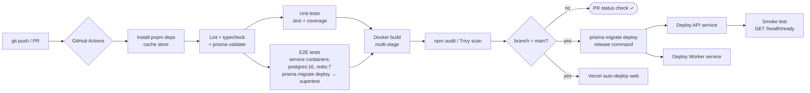

- **On every PR:** lint, typecheck, `prisma validate`, unit tests, e2e with Postgres/Redis service containers, Docker build, audit/scan. Required status check before merge.
- **On `main`:** host auto-deploys; `prisma migrate deploy` runs as the **release/pre-deploy command** (never `migrate dev` in prod), then API and worker deploy, then a smoke test hits `/health/ready`. Vercel deploys the web app independently.
- Migrations must be **backward compatible** (expand → migrate → contract) because the old version runs briefly alongside the new one.

---

## 23. Deployment and environments

### 23.1 Environments

| Env | Purpose | Data |
|---|---|---|
| `local` | Development | docker-compose |
| `preview` (optional) | Vercel previews hitting staging API | Staging DB |
| `production` | The live portfolio demo | Managed services, Stripe **test** mode |

### 23.2 Production topology (Railway example)
- Project with services: `api` (public, `api.yourdomain.com`), `worker` (private), `postgres`, `redis`.
- `web` on Vercel at `app.yourdomain.com`, env `NEXT_PUBLIC_API_URL`.
- R2 bucket `saas-xray-files`, CORS allowing `app.yourdomain.com` for presigned POST.
- Stripe webhook endpoint registered at `https://api.yourdomain.com/v1/webhooks/stripe`.
- Google OAuth redirect URI `https://api.yourdomain.com/v1/auth/google/callback`.

### 23.3 Gotchas
- **Free tiers that sleep** (Render free) add 30–60 s cold starts — fatal when a founder clicks your link. Use a plan that stays awake for the API.
- **Upstash Redis + BullMQ:** BullMQ polls/blocks constantly and can burn through command-based pricing; use a normal Redis instance.
- **WebSockets on hosts:** Railway/Fly/Render support them; Vercel serverless does not — another reason the API isn't on Vercel.
- Set `trust proxy` so rate limiting sees the real client IP, not the load balancer's.

---

## 24. Configuration and environment variables

Validated by zod at boot. `.env.example` is committed; real `.env` never is.

| Variable | Example | Used by |
|---|---|---|
| `NODE_ENV` | `production` | all |
| `PORT` | `3000` | api |
| `APP_URL` / `WEB_ORIGIN` | `https://api.yourdomain.com` / `https://app.yourdomain.com` | CORS, redirects, emails |
| `DATABASE_URL` | `postgresql://…` | Prisma |
| `REDIS_URL` | `redis://…` | queues, cache, throttler, pub/sub |
| `JWT_ACCESS_SECRET` | 64 random bytes | auth |
| `JWT_ACCESS_TTL` | `15m` | auth |
| `REFRESH_TOKEN_TTL_DAYS` | `7` | auth |
| `COOKIE_DOMAIN` | `.yourdomain.com` | auth |
| `GOOGLE_CLIENT_ID` / `GOOGLE_CLIENT_SECRET` / `GOOGLE_CALLBACK_URL` | — | OAuth |
| `STRIPE_SECRET_KEY` | `sk_test_…` | billing |
| `STRIPE_WEBHOOK_SECRET` | `whsec_…` | webhooks |
| `STRIPE_PRICE_PRO` | `price_…` | billing |
| `S3_ENDPOINT` / `S3_REGION` / `S3_BUCKET` / `S3_ACCESS_KEY_ID` / `S3_SECRET_ACCESS_KEY` | R2 (or the local S3-compatible store) values | files |
| `MAIL_PROVIDER` / `RESEND_API_KEY` / `MAIL_FROM` | `resend` / … / `"App <no-reply@yourdomain.com>"` | mail |
| `SMTP_HOST` / `SMTP_PORT` | `localhost` / `1025` | local mail (Mailpit) |
| `RUN_WORKERS` | `false` | api (true = in-process workers) |
| `XRAY_ENABLED` | `true` | xray |
| `DEMO_ENABLED` / `DEMO_TTL_HOURS` | `true` / `24` | demo |
| `TURNSTILE_SECRET` | — | demo |
| `BULL_BOARD_USER` / `BULL_BOARD_PASSWORD` | — | admin |
| `LOG_LEVEL` | `info` | logger |
| `SENTRY_DSN` (optional) | — | errors |

---

## 25. Scalability and future evolution

| When… | Do this | Why it's easy |
|---|---|---|
| Traffic grows | Run more `api` instances | Stateless API; sessions in DB/Redis; Socket.IO Redis adapter |
| Queues back up | Scale `worker` replicas; split heavy queues into their own worker | Queues are already separated by workload |
| Read load grows | Read replica for reports/dashboard; longer cache TTLs | Reads already go through services |
| Enterprise customer | Postgres RLS; SSO (SAML/OIDC); audit-log export | Tenant context already centralised |
| Need real tracing | Replace X-ray producers' transport with OpenTelemetry spans → Grafana/Honeycomb | X-ray events already map 1:1 to spans |
| One module needs independent scaling | Extract it (e.g. reports) as a service consuming the same queue | Module boundaries + events/queues are the seams |
| Public API adoption | Outgoing webhooks to customers (signed, retried via BullMQ) | Same patterns as Stripe incoming webhooks |

---

## 26. Delivery roadmap

| Phase | Modules (in build order) | Done when |
|---|---|---|
| **1 — Pitchable core** | Monorepo + docker-compose → Config/Prisma/Logger/Context/Health → Prisma schema (users, orgs, memberships, invitations, tasks, clients, invoices) → Auth (register, login, refresh rotation, verify, reset) → Google OAuth → Orgs + RBAC guards + tenant extension → Invitations → Tasks/Clients/Invoices CRUD → Global filter + validation + Swagger → Demo endpoint (seed clone) → Deploy (Railway + Vercel + domain) | A founder can click "Try demo", use tasks/invoices, invite a teammate; Swagger live at `/docs` |
| **2 — SaaS platform** | Queue module + email processor (move emails to jobs) → Worker process split → Stripe checkout/portal + webhook + entitlements → Files (R2 presigned) → Realtime gateway + notifications → Reports + invoice PDF jobs → API keys + rate limiting + caching | Upgrading to PRO via test card works end-to-end; uploads and live notifications work |
| **3 — Show-off & quality** | X-ray service + producers + panel UI + "try it" buttons → Audit log + UI → Unit + e2e + tenant isolation suite → GitHub Actions CI → README (this doc condensed + diagrams) → Demo video | CI green on PRs; X-ray visibly narrates every click; 2–3 min demo video recorded |

---

## 27. Talking points for client calls

Short, defensible answers you can give founders:

- **"Why a monolith?"** — Modular monolith with clean module boundaries and queues at the seams: one deploy, one database, low cost, and each module can be extracted later without a rewrite.
- **"How do you stop one customer seeing another's data?"** — Three layers: a guard checks membership, the data layer automatically scopes every query by organisation, and an automated test suite tries to break it on every endpoint.
- **"What happens if Stripe sends the same webhook twice?"** — We verify the signature, record the event ID, and ignore duplicates; the work runs in a retried background job, so nothing is lost or double-charged. (Then show it in the X-ray panel.)
- **"How do you handle auth securely?"** — Short-lived access tokens, rotating refresh tokens in HttpOnly cookies with theft detection, argon2 password hashing, rate-limited login.
- **"What if a background job fails?"** — Exponential-backoff retries, idempotent processors, and a dead-letter set we can inspect and replay from a dashboard.
- **"Can it scale?"** — The API is stateless, so we add instances; workers scale separately; WebSockets share state through Redis.

---

### Appendix A — Diagram index

All diagrams are generated from Mermaid sources in [`diagrams/`](diagrams/) (edit the `.mmd` and re-render with `npx @mermaid-js/mermaid-cli -i diagrams/x.mmd -o images/x.png`). GitHub also renders the Mermaid sources natively if you paste them into a ```` ```mermaid ```` block in the README.

| Image | Source |
|---|---|
| System context | `diagrams/01-system-context.mmd` |
| Module map | `diagrams/02-module-map.mmd` |
| Request lifecycle | `diagrams/03-request-lifecycle.mmd` |
| ERD | `diagrams/04-erd.mmd` |
| Auth flow | `diagrams/05-auth-flow.mmd` |
| Stripe webhook flow | `diagrams/06-stripe-webhook.mmd` |
| X-ray pipeline | `diagrams/07-xray-pipeline.mmd` |
| Background jobs | `diagrams/08-jobs.mmd` |
| File upload | `diagrams/09-file-upload.mmd` |
| CI/CD | `diagrams/10-ci-cd.mmd` |
| Demo flow | `diagrams/11-demo-flow.mmd` |

### Appendix B — Glossary (for non-technical readers of the README)

- **Multi-tenant:** many customer companies share one app, but each only sees its own data.
- **RBAC:** role-based access control — what an Owner, Admin or Member is allowed to do.
- **Webhook:** another service (Stripe) calling our server to tell us something happened.
- **Queue / background job:** work done a moment later, outside the click, so the app stays fast.
- **Idempotent:** doing the same thing twice has the same effect as doing it once.
- **Presigned URL:** a temporary, permission-limited link to upload or download a file directly from storage.
- **Rate limiting:** capping how many requests someone can make per minute to prevent abuse.
